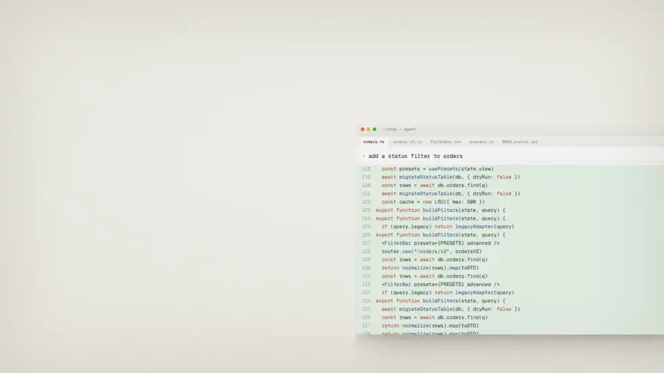

# LoopForge

English | [简体中文](README.zh-CN.md)

**Make coding agents deliver through a workflow you can confirm, review, and resume—not just produce code.**

LoopForge installs into the coding agent you already use: CodeBuddy, Codex, Cursor, Claude Code, or Pi. Inside that agent it runs a role-based delivery workflow. The requirement is clarified and confirmed first, then the work is designed, implemented, reviewed by a different role from the one that wrote the code, and tested. Stages run one after another, each handled by its own role. You don't run several agents side by side. Decisions, review findings, and test results are saved along the way, so you can inspect the work and pick it up again after an interruption.

<p align="center">
  <a href="docs/assets/loopforge-promo.mp4?raw=true">
    
  </a>
</p>

## Quick start

Requires Node.js 20+ and Python 3.8+. The commands below install the default Classic Edition; choose it if you are unsure.

| Agent | Install | Start a workflow |
| --- | --- | --- |
| CodeBuddy | `npx -y loopforge-cli@latest install codebuddy` | `/start-devflow "<request>"` |
| Codex | `npx -y loopforge-cli@latest install codex` | `$devflow-codex "<request>"` |
| Cursor | `npx -y loopforge-cli@latest install cursor` | `/start-devflow "<request>"` |
| Claude Code | `npx -y loopforge-cli@latest install claude` | `/start-devflow "<request>"` |

For example, with Claude Code:

```bash
npx -y loopforge-cli@latest install claude
npx -y loopforge-cli@latest status claude
```

```text
/start-devflow "add status filtering to the order list and cover the API with tests"
```

Check any installation with `npx -y loopforge-cli@latest status <agent>`. If installation or execution fails, diagnose the environment:

```bash
npx -y loopforge-cli@latest doctor
```

Pi is supported through the [Portable Edition](#portable-edition).

## How it works

1. **Understand the problem first**: the agent inspects the project and clarifies the goal, scope, and acceptance criteria instead of immediately writing code.
2. **Confirm the boundaries before implementation**: medium and large tasks move into design and implementation only after you confirm the goal, scope, exclusions, key decisions, and acceptance criteria.
3. **Separate responsibilities**: design, implementation, review, and testing are handled stage by stage by roles with independent responsibilities, which reduces self-review bias in a single context.
4. **Show evidence, not just a diff**: requirements, plans, changes, review findings, and test results are saved for inspection, handoff, and retrospectives.
5. **Continue after interruption**: workflow state is persisted so the next session can resume at the unfinished stage instead of starting over.

LoopForge picks the path by task complexity. Small changes take a streamlined single-role path; the full role-based workflow is reserved for medium and large tasks that benefit from it.

```text
Your request
   │
   ├─ Small change ───────> Understand → implement → verify → deliver
   │
   └─ Medium/large task ──> Clarify and confirm → design → implement
                                                   → independent review → test → deliver
                              │
                              └── State and artifacts are saved throughout
```

## Supported agents

| Agent | Classic Edition (default) | Portable Edition |
| --- | --- | --- |
| CodeBuddy | ✓ | ✓ |
| Codex | ✓ | ✓ |
| Cursor | ✓ | ✓ |
| Claude Code | ✓ | ✓ |
| Pi | — | ✓ |

LoopForge enables only one edition per coding agent in each project. See [`EDITIONS.md`](EDITIONS.md) for the differences and directory layout.

## What you get

At the end of a task, you get the code changes together with the confirmed requirement, technical design, independent review findings, test results, and delivery summary. LoopForge saves this history under `artifacts/{task_slug}/` by default for inspection, handoff, and retrospectives.

<details>
<summary>View the default artifact layout</summary>

Some directory names differ between editions.

```text
01-requirement/   Confirmed goals, scope, and acceptance criteria
02-design/        Technical design and execution plan
03-code/          Code changes and independent review report
04-e2e/           Test results
05-knowledge/     Reusable project knowledge
workflow-summary.md
```

</details>

Resume an interrupted Classic workflow with `/resume-devflow {task_slug}` on CodeBuddy, Cursor, or Claude Code, and with `$devflow-codex resume {task_slug}` on Codex. Each installed host bundle documents its status, abort, and individual-stage commands.

## See how agents work

The Classic Edition for CodeBuddy includes a local observability dashboard. It turns the workflow evidence into a view of session activity, Token and cost trends, Skill/Rule usage, role dispatch, and Devflow stage attribution—useful for finding expensive runs, checking whether automation is actually being used, and reviewing how work moved between roles.


_Dashboard example using synthetic demonstration data._

The dashboard is generated and served locally; it does not require an external telemetry service. Runtime logs can contain tool arguments and output excerpts, so LoopForge excludes them from Git by default and they should not be shared without review.

<details>
<summary>Open the local dashboard</summary>

After running at least one CodeBuddy session from the project root:

```bash
python3 .codebuddy/skills/agent-observability/scripts/build_dashboard_data.py --project-root .
python3 -m http.server 8765 --directory .codebuddy/skills/agent-observability/scripts/dashboard
```

Open `http://localhost:8765`. See the [observability quickstart](.codebuddy/skills/agent-observability/references/quickstart.md) for data sources, custom pricing, and troubleshooting.

</details>

## When LoopForge is useful

LoopForge is especially useful when:

- the request is still ambiguous and the goal or boundaries need clarification;
- a change crosses multiple modules and should be designed before implementation;
- implementation, review, and testing should be performed by separate roles;
- work may span multiple sessions and needs resumable state;
- the team wants an inspectable delivery record for handoff or retrospectives.

For one-off code completion or a tiny, fully specified edit, using a coding agent directly is often enough. Simple tasks that do enter LoopForge use its streamlined path.

## Portable Edition

The Classic Edition from the quick start is the right choice for most users. If you only want the portable Agent Skills workflow, use the Portable Edition. To prevent one coding agent from loading two workflows and mixing their state or artifacts, LoopForge enables only one edition per coding agent in each project. To switch editions, run the new install command with `--force`.

| Agent | Install | Start a workflow |
| --- | --- | --- |
| CodeBuddy | `npx -y loopforge-cli@latest skills install codebuddy` | `/devflow "<request>"` |
| Codex | `npx -y loopforge-cli@latest skills install codex` | `$devflow "<request>"` |
| Cursor | `npx -y loopforge-cli@latest skills install cursor` | `/devflow "<request>"` |
| Claude Code | `npx -y loopforge-cli@latest skills install claude` | `/devflow "<request>"` |
| Pi | `npx -y loopforge-cli@latest skills install pi`, then `pi install npm:pi-subagents` | `/skill:devflow "<request>"` |

See [`EDITIONS.md`](EDITIONS.md) for the complete boundaries and directory layout.

## Update and uninstall

For ongoing use, install the CLI globally:

```bash
npm install --global loopforge-cli
```

Then maintain an installation with the same agent names as above (`codebuddy`, `codex`, `cursor`, `claude`, and `pi` for the Portable Edition):

```bash
# Classic Edition
loopforge update <agent>
loopforge status <agent>
loopforge uninstall <agent>

# Portable Edition
loopforge skills update <agent>
loopforge skills status <agent>
loopforge skills uninstall <agent>
```

Installation state is stored in `.devflow/install-state.json`. An update stops instead of overwriting user-modified or conflicting files. Use `--force` only when you intend to replace conflicts or switch editions, preferably after inspecting `loopforge plan`.

If you have cloned this repository, install the LoopForge CLI from the current source tree by running this in the repository root:

```bash
pipx install .
```

## Optional tools

`tools/tcmcp` is a Tencent Cloud read-only MCP Initializr (Redis, CDB, TDSQL-C, TKE, CLS, COS). It is not part of `loopforge install` or the npm CLI package. From a clone:

```bash
cd tools/tcmcp
```

Then follow [`tools/tcmcp/README.md`](tools/tcmcp/README.md). Cloud API keys are not written into generated zips or the container image; they stay on the machine that lists resources or installs the MCP client. LoopForge `vX.Y.Z` releases publish `ghcr.io/tencent/loopforge-tcmcp:<version>`.

## Permissions and security

Some Classic host configurations enable automatic execution or high-permission agent modes. Use LoopForge only in trusted projects. Before installation, inspect planned files with `loopforge plan codebuddy`, `loopforge plan codex`, `loopforge plan cursor`, or `loopforge plan claude`. Do not put credentials, private endpoints, or production operations configuration in workflow templates.

See [`SECURITY.md`](SECURITY.md) and report vulnerabilities privately through GitHub Security Advisories.

## Community

Scan the WeCom QR code below to join the LoopForge community group.


## Contributing

Issues and pull requests are welcome. Read [`CONTRIBUTING.md`](CONTRIBUTING.md) and the repository `AGENTS.md` before changing workflow behavior. See [`CHANGELOG.md`](CHANGELOG.md) for release history.

## License

MIT. See [`THIRD_PARTY_NOTICES.md`](THIRD_PARTY_NOTICES.md) for third-party notices.
