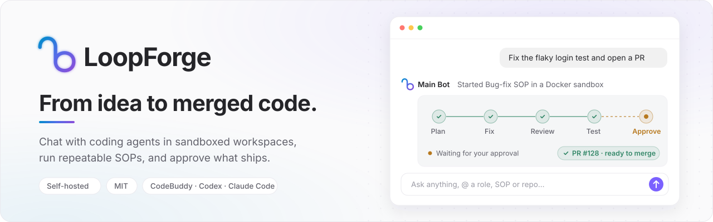
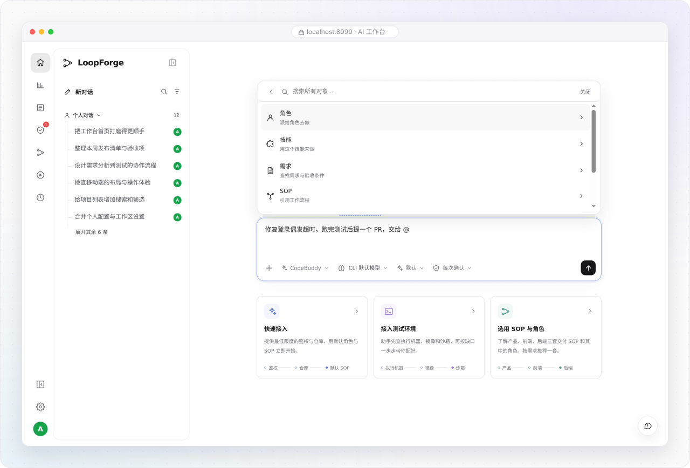
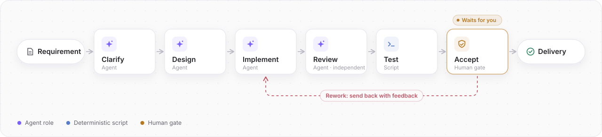
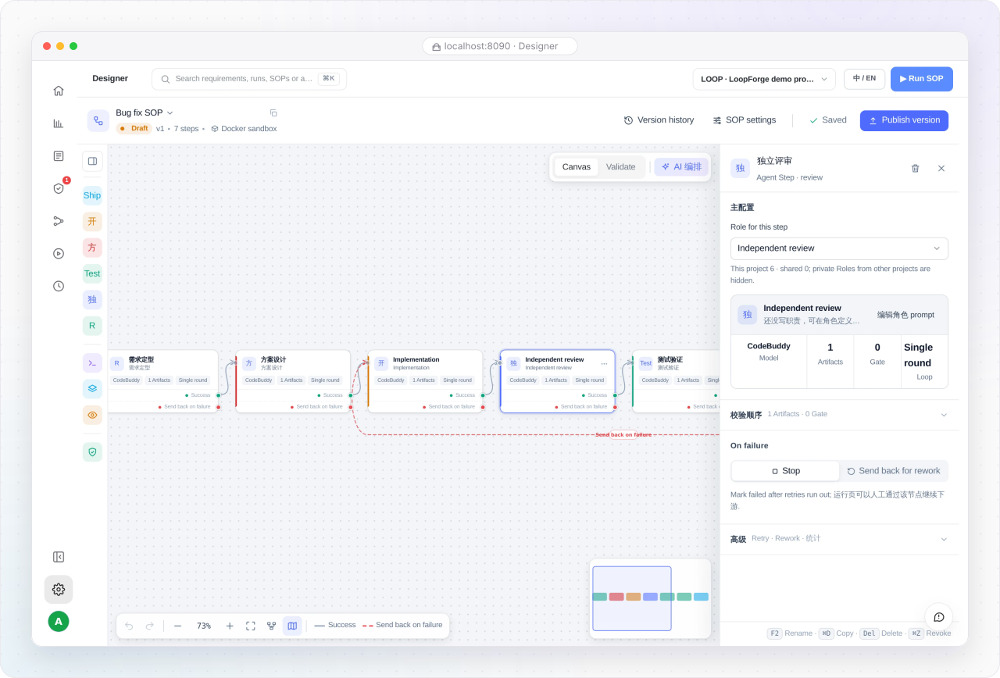
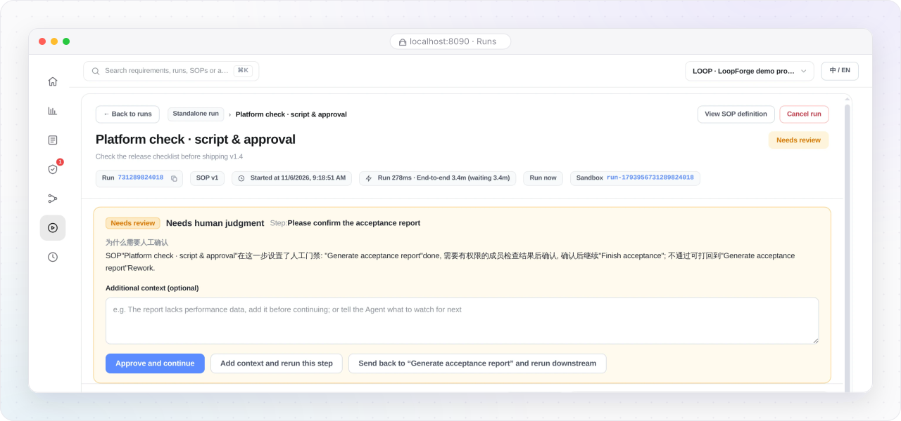
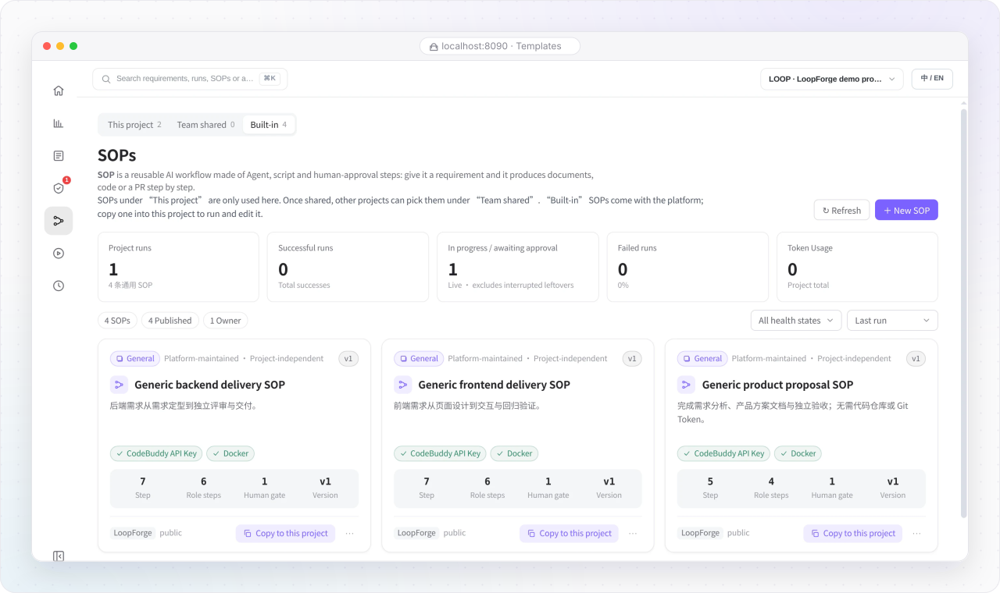

<p align="center">
  <picture>
    <source media="(prefers-color-scheme: dark)" srcset="docs/assets/readme/hero-en-dark.svg">
    
  </picture>
</p>

<p align="center">
  <a href="https://github.com/Tencent/LoopForge/actions/workflows/platform.yml"></a>
  <a href="https://www.npmjs.com/package/loopforge-cli"></a>
  <a href="LICENSE"></a>
  
  <a href="https://github.com/Tencent/LoopForge/stargazers"></a>
</p>

<p align="center">
  <a href="https://trendshift.io/repositories/300138?utm_source=repository-badge&amp;utm_medium=badge&amp;utm_campaign=badge-repository-300138" target="_blank" rel="noopener noreferrer"></a>
</p>

<p align="center">
  <b>English</b> · <a href="README.zh-CN.md">简体中文</a>
</p>

<p align="center">
  <a href="#two-ways-to-work">Two ways to work</a> ·
  <a href="#quick-start">Quick start</a> ·
  <a href="#how-sops-work">SOPs</a> ·
  <a href="#features">Features</a> ·
  <a href="#loopforge-local">Local</a> ·
  <a href="#faq">FAQ</a> ·
  <a href="#documentation">Docs</a>
</p>

https://github.com/user-attachments/assets/8af401d9-1aae-427c-b4bc-455c12d17beb

<p align="center"><sub>80-second product tour (1080p, with sound).</sub></p>

**LoopForge** is a self-hosted workspace where your team ships software with coding agents. Describe what you need to **Main Bot** in chat: it opens a Docker sandbox, checks out your repositories, delegates to project roles, and opens the PR. When a way of working proves itself, save it as an **SOP** (a standard workflow of agents, scripts and human gates) so the next requirement is delivered the same way, with review and approval built in. SOPs also support [conditional routing and branch joins](docs/sop-conditional-routing.md).

Coding-agent CLIs do the work: CodeBuddy, Codex, Claude Code, OpenCode, Cursor CLI, Antigravity, Kimi Code, Pi, DeepSeek Harness and ZCode. LoopForge adds the roles, sandboxes, checkpoints and history around them, all on your own infrastructure under the MIT license.

## Two ways to work

| | **Chat with Main Bot** | **Run an SOP** |
| --- | --- | --- |
| Best for | Exploring, quick fixes, iterating with the agent | Repeatable delivery with fixed stages and sign-off |
| How it runs | Main Bot opens a [conversation workspace](docs/conversation-workspaces.md) (a Docker sandbox with your repos) on demand and calls project roles as subagents | The engine runs Agent, Script, Human-gate and sub-SOP nodes in order, in their own sandbox |
| You stay in control by | Queuing or steering messages mid-reply, and pausing, resuming or taking over a running SOP from chat | Approving at human gates, sending work back to a chosen step, retrying or rerunning from any node |
| Delivers | A PR/MR, or a direct merge into a shared branch (`mode=direct`) | Documents, code or a PR, plus per-node artifacts and logs |

Both paths track the same **requirements**, so every change, whether made in chat or by an SOP, links back to what was asked for and counts toward delivery and cost reports.

<p align="center">
  <picture>
    <source media="(prefers-color-scheme: dark)" srcset="docs/assets/readme/chat-home-dark.svg">
    
  </picture>
</p>

<p align="center"><sub>The chat home. Type a request, <code>@</code> a role, skill, requirement, SOP or repository, and pick the executor, model and permission mode per conversation.</sub></p>

## Why LoopForge

Ask a coding agent to "fix this bug" and the result depends on that run. It might skip the plan, forget the tests, review its own code, or stop halfway without anyone noticing. That's fine for a demo, but it isn't how a team ships.

- **Repeatable.** Same SOP, same stages, same checks for every requirement. Start from built-in backend, frontend, bug-fix and product SOPs.
- **Separated roles.** Planning, implementation, review and testing each get their own prompt, executor, model, rules, Skills and MCP tools. A role works as an SOP node or as a subagent in chat.
- **Human in the loop.** Approval gates where they matter. Read the report, approve, or send the work back to a chosen step.
- **Observable and resumable.** Node status, tool traces, logs and artifacts in one place. Pause, retry a failed step, or rerun from any node.
- **Your stack, your servers.** Ten coding-agent CLIs as executors, from CodeBuddy, Codex and Claude Code to OpenCode, Cursor CLI and more. GitHub, Skills and MCP as tools. Docker sandboxes or your own machine as the runtime.

## Quick start

Install **Git** and clone the repository first. The installer checks Docker, Compose, Python 3 and curl and offers to install missing components. Python/curl installation supports apt, dnf and yum on Linux; the Compose plugin supports x86_64/arm64 and verifies the official release SHA-256. macOS needs a working Python 3 and Docker Desktop; Homebrew can install missing components. Ordinary Linux users are supported through Docker group access or sudo. Set `LOOPFORGE_YES=1` to accept installation prompts. Package and image downloads require internet access.

```bash
git clone https://github.com/Tencent/LoopForge.git
cd LoopForge
./start.sh
```

`./start.sh` pulls the GHCR release image pinned in `compose.yaml` without building locally (`bash scripts/install.sh` does the same). It creates the MySQL and platform services, generates configuration and session secrets, and installs the built-in sandboxes, starter SOPs and welcome project. Host Go and Node.js installations are not required. Configure model API keys and GitHub authorization after startup. Use `./start.sh logs`, `stop`, `restart` or `pull` to manage it, and `./start.sh dev` to build the checkout from source.

If downloads from `ghcr.io` stall, set `MIRROR` to a registry host that can stand in for `ghcr.io`. `./start.sh` pulls from that host and tags the image back to the name pinned in `compose.yaml`. Setting `MIRROR` trusts that host, because the download is tagged with the official name. The GitHub Release records the digest; `docker image inspect --format '{{index .RepoDigests 0}}' ghcr.io/tencent/loopforge:<pin>` should show the same digest after `@`. Without `MIRROR`, `./start.sh` still pulls `ghcr.io` directly, and `compose.yaml` stays unchanged. Upgrade with the same variable and `./start.sh pull`. [ghcr.nju.edu.cn](https://doc.nju.edu.cn/books/e1654/page/ghcr) is one such host. A Docker `registry-mirrors` entry such as `https://docker.nju.edu.cn` only accelerates Docker Hub and is not a value for `MIRROR`.

```bash
MIRROR=ghcr.nju.edu.cn ./start.sh
```

Open the address printed by the installer and create your account; the first one becomes the administrator. The service listens on `0.0.0.0:8090` by default. On a cloud host, the installer reads the public IP from the provider's metadata service and prints it; allow the port in your security group, or put an HTTPS reverse proxy in front. Restrict access to your own IP until the administrator account exists. The home page's quick-access guide walks you through adding a model key, connecting a repository and choosing an SOP.

For GitLab, Gitea, Gogs and other Git hosts, [set up Git SSH](docs/deployment.md#git-repositories-over-ssh) to check out and push branches with a personal key. PR/MR and Issue automation requires a hosting API token or a separately configured MCP.

### Try it without an API key

New accounts join the **LoopForge demo project**, which includes an SOP made only of a script and a human gate:

1. Switch to the demo project, open **Templates**, and open **Platform check · script & approval**.
2. Click **Run SOP**. A real script writes a report, then the run waits for you at the approval step.
3. Approve it from **Needs review** or the run page, and watch the run continue to its final artifact.

### What you need for real work

| I want to… | You need |
| --- | --- |
| Run the script + approval demo | Nothing |
| Chat with Main Bot, generate a document or a new project | An API key for the selected executor |
| Change an existing repository (in chat or via an SOP) and open a PR | Model credentials and a GitHub repository (connect GitHub in personal settings) |

<details>
<summary><b>More setup details</b>: executors, GitHub, sandboxes, access model</summary>

<br>

- **Executors.** Pick one of ten CLIs beside the home composer, then a model. Every SOP role can choose its executor independently (built-in roles default to CodeBuddy). Requirement clarification, AI notification summaries, Bot replies and run evals currently use CodeBuddy, so their model pickers list CodeBuddy models only and the server refuses a model of another CLI instead of switching it to CodeBuddy; scheduled assistant tasks run on the CLI the task selects.

  | Executor | Credentials | Installation |
  | --- | --- | --- |
  | **CodeBuddy** | Personal key, or a shared key an administrator configures for chat and SOP runs | In the Docker image |
  | **Codex** | Personal key; a connected execution machine can use its local login | In the Docker image |
  | **Claude Code** | Personal key; a connected execution machine can use its local login | Installed from npm on first use, then cached |
  | **OpenCode · Kimi Code · Pi** | Personal key only | Installed from npm on first use, then cached |
  | **DeepSeek Harness** | Personal key only | In the Docker image |
  | **Cursor CLI · Antigravity** | Personal key only | Provider installer on first chat use; not installed into SOP sandboxes |
  | **ZCode** | Personal key only | Not bundled; install it on the service or execution machine PATH |

  The seven agent CLIs after Claude Code keep their model and MCP configuration in a private home directory per run, so they always use the responsible user's own key and Base URL from personal settings, even on a connected execution machine. When rolling them out to a team, each member configures their own credentials. First-use installs need npm or provider access; [native deployments](docs/deployment.md#workers-and-runners) need the CLI for the executor you choose.
- **GitHub is optional.** All built-in generic SOPs run without a repository: product SOPs deliver documents, and new frontend/backend projects deliver source files in the task workspace. Bug fixes still need source code and reproduction details. Connect a repository when you work on existing code or want PRs.
- **Delivering to a repository.** Choose **Connect GitHub** in personal settings, approve the device code on GitHub and pick your repository (the LoopForge OAuth App is built in; no PAT required, manual PAT entry still works). Set executor credentials (or bind a local execution machine), then either run a project SOP or ask Main Bot to change the code and submit a PR/MR.
- **Sandboxes.** In the default Compose installation, SOP runs and conversation workspaces both use Docker sandbox containers started through the host Docker socket. Default sandboxes reuse the installed runtime image, so nothing extra is built after installation; custom Dockerfiles still build their own images. Docker socket access grants control of the host daemon, so this setup is for trusted teams, not untrusted multi-tenant isolation. See [deployment boundaries](docs/deployment.md#accounts). Re-running the installer keeps your data.
- **Accounts and access.** New installations listen on all interfaces (existing bind settings are kept) and are designed for a trusted team: signed-in users can read project data across the instance, and teammates can sign up from the login page (`AGENTFLOW_ALLOW_SIGNUP=false` in `.env` turns that off). Read the [account and access model](docs/deployment.md#accounts) before exposing it beyond your team.
- **Remote access, HTTPS, separate workers.** See [Deployment](docs/deployment.md).
- **Hacking on LoopForge itself?** `bash scripts/dev.sh` runs it natively (Go 1.26.11+).

</details>

## How SOPs work

An **SOP** is the workflow a delivery follows. Agents, scripts and people take part in the same run:

<p align="center">
  <picture>
    <source media="(prefers-color-scheme: dark)" srcset="docs/assets/readme/sop-flow-en-dark.svg">
    
  </picture>
</p>

<p align="center">
  
</p>

<p align="center"><sub>The SOP designer with the built-in bug-fix SOP. Each step picks a role; failed checks can send the work back to an earlier step.</sub></p>

| Node | What it does |
| --- | --- |
| **Agent** | A role (prompt, executor, model, rules, Skills and MCP tools) that designs, implements, reviews or tests. |
| **Script** | A deterministic shell step: build, test, lint, generate a report. No AI where AI is not needed. |
| **Human gate** | Pauses the run until someone checks the artifacts and approves, or sends the work back to a step. |
| **Sub-SOP** | Runs another SOP as a sub-workflow. |
| **Preview build** | Builds a static site and archives it for review. |

Each node declares its artifacts and dependencies, and the engine starts each step once its dependencies complete. Start from a built-in SOP, adapt its roles, rules and environment to your project, and publish versions as it evolves.

<p align="center">
  
</p>

<p align="center"><sub>A run waiting at a human gate: approve and continue, add context and rerun the step, or send the work back upstream.</sub></p>

**A delivery we actually ran:** four CodeBuddy roles planned a Python fix, implemented it, reviewed it independently and summarized the delivery. Three real tests passed; the run waited for human approval, then verified the accepted code had not changed. The [reusable acceptance case](e2e/api/45-delivery-model.test.mjs) checks the files and results. See the [validation record](docs/validation.md) for scope and known gaps.

## Features

| Area | What you get |
| --- | --- |
| **Chat workbench** | Main Bot with per-conversation executor, model and permission mode. `@` references for roles, skills, requirements, SOPs and repositories. Messages queue while a reply runs; *Steer* interrupts and sends now. Generated files open in a side panel with preview, source and download. |
| **Conversation workspaces** | On-demand Docker sandboxes with the project's repositories checked out, project roles as native subagents, and direct control of a running SOP workspace: pause, resume or take over. |
| **SOP designer** | Visual canvas with Agent, Script, Human gate, Sub-SOP and Preview nodes, rework-on-failure edges, validation, version history and publishing. Built-in backend, frontend, bug-fix and product SOPs. |
| **Roles** | Reusable definitions: prompt, executor, model, rules, Skills, MCP tools, artifacts and gates, shared across SOP nodes and chat subagents. |
| **Requirement → delivery** | Requirements tracked end to end, whether shipped by an SOP or straight from chat, with PR/MR status tracking, merge detection and direct-branch merges. |
| **Runs & approvals** | Live node status, tool traces, worker logs, per-node artifact snapshots and workspace previews. A single **Needs review** inbox for every gate waiting on you. |
| **AI scheduled tasks** | Recurring agent tasks with full workspace, SOP and MCP access; a shared market of versioned, parameterized task templates; automatic SOP dispatch for new requirements. |
| **Insights & cost** | Engineering metrics, business-domain reports with static HTML/SVG export, and token/cost accounting for SOPs and conversations at public list prices. |
| **Execution environments** | Platform workers, Docker sandboxes, or a connected local execution machine using your own tools and repositories. |
| **Team-ready** | Password accounts, projects and members, light/dark/system themes, an OpenAPI-described HTTP and MCP API. Management pages are in English and Chinese; the chat workbench is Chinese for now. |

<p align="center">
  
</p>

<p align="center"><sub>Built-in SOPs are read-only blueprints; copy one into your project to run and edit it.</sub></p>

## LoopForge Local

Don't want to run a server? **LoopForge Local** brings the built-in delivery workflows straight into the coding assistant you already use:

```bash
# Run inside your target project, e.g. for Claude Code
npx -y loopforge-cli@latest install claude
```

Then run `/start-devflow "<your request>"` in Claude Code.

| Host | Supported |
| --- | --- |
| Claude Code · CodeBuddy · Codex · Cursor | Classic (default) and Portable editions |
| Pi | Portable edition |
| DeepSeek Harness | Portable edition |
| Hermes Agent | Portable edition |

See the [local guide](docs/local/usage.md) for each host's entry point and [editions](docs/local/editions.md) for the differences. Source lives in [`local/`](local/). Local runs the built-in workflows today; exporting a platform SOP for standalone local execution is planned.

| | Platform | Local |
| --- | --- | --- |
| Best for | Teams sharing chat workspaces, SOPs, approvals and history | One developer inside an IDE or CLI |
| Needs | Docker + Python 3 | Node.js 20+, Python 3.8+ and a coding assistant |
| Workflows | Chat with Main Bot + custom SOPs on a visual canvas | Built-in Classic / Portable workflows |
| Evidence | Shared run details, approvals and metrics in the web workspace | Artifacts under `artifacts/{task_slug}/` + optional local dashboard |

## FAQ

**Do I need an API key to try it?**
No. The demo SOP uses only a script and a human gate. Chat and agent steps need a key for the executor you pick. Model usage is not included; you bring your own credentials.

**Do I need GitHub?**
No. Chat, documents and new projects run in the task workspace. Connect GitHub when you want to change an existing repository or open PRs.

**Should I use chat or an SOP?**
Use chat to explore and iterate; Main Bot can still open a PR. Once you find a way of working you want every requirement to follow, with fixed reviewers, tests and sign-off, put it in an SOP. Main Bot can start, pause and take over SOP runs, so the two paths work together.

**How is this different from Dify, n8n or Flowise?**
Those are general-purpose AI and automation workflow builders. LoopForge is built for **software delivery with coding agents**: implementer and reviewer roles, Docker sandboxes with real repositories, GitHub delivery, human acceptance gates and run evidence.

**How is this different from using Claude Code, Codex, CodeBuddy or another coding CLI directly?**
LoopForge doesn't replace them; it orchestrates them. Each agent step and each chat turn runs one of those CLIs. LoopForge adds what surrounds it: who does what, in which sandbox, in which order, with which checks, and who signs off.

**Is it safe to expose on the internet?**
New installations listen on all interfaces and target a trusted team. Read the [account and access model](docs/deployment.md#accounts) and set up HTTPS before opening it up. Report vulnerabilities privately via the [security policy](SECURITY.md).

## Documentation

| I want to… | Start here |
| --- | --- |
| Deploy, manage accounts, connect execution machines | [Deployment](docs/deployment.md) |
| Understand chat workspaces, scheduled AI tasks and token pricing | [Conversation workspaces](docs/conversation-workspaces.md) · [AI scheduled tasks](docs/ai-scheduled-task-capabilities.md) · [Token pricing](docs/token-pricing.md) |
| Install local workflows or choose an edition | [LoopForge Local](docs/local/usage.md) · [Editions](docs/local/editions.md) |
| Extend the platform or use the HTTP / MCP API | [Architecture](docs/architecture.md) · [API reference](docs/api/README.md) · [Shared schedules API](docs/api/shared-schedules.md) |
| Contribute to the UI | [Frontend design conventions](design.md) (Chinese) |
| Check functional coverage and release readiness | [Validation record](docs/validation.md) · [Acceptance matrix](docs/testing/acceptance-matrix.md) · [Release review](docs/release-readiness.md) |
| Understand source provenance and maintenance | [Public scope](docs/open-source-scope.md) · [Upstream synchronization](docs/upstream-sync.md) |

## Community

Scan the QR code to join the LoopForge community group.


## Contributing

Issues and PRs are welcome: share a use case, report a bug, or improve workflows, integrations and the platform experience. Start with the [contributing guide](CONTRIBUTING.md). Security issues go through the [security policy](SECURITY.md).

If LoopForge is useful to you, a star helps others find it.

<a href="https://star-history.com/#Tencent/LoopForge&Date">
  
</a>

## License

[MIT](LICENSE). Third-party components keep their own licenses and notices; see [THIRD_PARTY_NOTICES.md](THIRD_PARTY_NOTICES.md).
