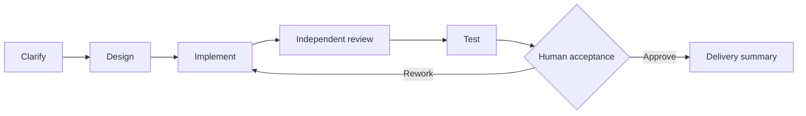

<p align="center">
  
</p>

<p align="center">
  <b>English</b> · <a href="README.zh-CN.md">简体中文</a>
</p>

<p align="center">
  <a href="#quick-start">Quick start</a> · <a href="#build-your-delivery-loop">Build a delivery loop</a> · <a href="#loopforge-local">Local workflows</a> · <a href="#documentation-and-contributing">Docs & contributing</a>
</p>

<p align="center">
  <a href="LICENSE"></a>
  
  
</p>

**Turn the way your team ships into a workflow agents can run.**

LoopForge brings **coding agents, scripts, and human decisions into one delivery workflow**. Describe a requirement, give each role a job, and follow the work from the first plan to the final artifact. Reuse the process for the next task.

- **Design the process.** Build SOPs on a visual canvas, with independent implementation, review, and test roles.
- **Keep control.** Inspect artifacts at human approval gates; retry a failed step or send work back for rework.
- **Bring your tools.** CodeBuddy, Codex, Claude Code, GitHub, Skills, and MCP. Self-hosted, **MIT licensed**.

<p align="center">
  
</p>

<p align="center"><sub>The actual workflow editor: generate a report, request human approval, and continue. Add agent nodes from the palette. Built-in template content is shown in Chinese.</sub></p>

## Quick start

Requires **Docker with Compose and Python 3**. If Docker is missing, the installer offers to install it (Linux through get.docker.com, macOS through Homebrew). Run:

```bash
git clone https://github.com/Tencent/LoopForge.git
cd LoopForge
bash scripts/install.sh
```

Open **[http://localhost:8090](http://localhost:8090)** and create your account — the first account becomes the administrator. Teammates can sign up from the same page (set `AGENTFLOW_ALLOW_SIGNUP=false` in `.env` to turn that off). The home page then walks you through adding a model key and running your first SOP.

The default deployment listens on localhost and is designed for a trusted team. Signed-in users can read project data across the instance; review the [account and access model](docs/deployment.md#accounts) before allowing access beyond your team.

The installer builds the image, starts MySQL and the platform, and installs the built-in SOPs and a welcome project. AI SOPs run in Docker sandbox containers that the platform starts through the host Docker socket; the platform builds the sandbox image in the background right after the first start (a few minutes). Re-running the installer keeps your data. Working on LoopForge itself? `bash scripts/dev.sh` runs it natively (needs Go 1.26.9+). See [deployment](docs/deployment.md) for remote access, HTTPS, and separate workers.

**Try a complete run without model credentials:**

1. On the home page, click **Try it now** in the getting-started list (step 4). New accounts join the **LoopForge demo project** automatically.
2. The sample SOP generates a report with a script. A short tour points out the step graph, the artifacts and the approval.
3. Approve the human gate, then watch the SOP continue and save its final artifact.

GitHub is optional. Chat and document-generation tasks that do not depend on a repository only need model credentials; script-only and human-approval workflows need neither a model key nor GitHub. Connect a repository and configure the responsible user’s GitHub token when using built-in code-delivery SOPs, analyzing repository code, or submitting PRs.

| Your first task | What to configure |
| --- | --- |
| Run the script + approval demo | Nothing — no model key or repository needed. |
| Chat, explore capabilities, or generate a document | An API key for the selected executor. |
| Analyze private code or deliver a repository change | Model credentials, a GitHub repository, and the responsible user's Git token. |

**When you need to deliver repository code, connect GitHub:**

1. Add a GitHub repository. Configure your Git token and executor credentials in personal settings, or bind a local execution machine.
2. Open **SOPs → Built-in** and pick one. Each card shows what it needs to run (API key, GitHub repository, Docker). Copy it into your project when you want to customize it.
3. Create a requirement, select its SOP, and start. Follow execution, approvals, and delivery from the workspace.

Choose **CodeBuddy, Codex, or Claude Code** beside the home composer, then select the model. Each executor uses its own credentials from personal settings. SOP roles can choose their executor independently. Built-in SOP roles default to CodeBuddy and can be changed. Requirement clarification, scheduled assistant tasks, and AI notification summaries currently use CodeBuddy. The Docker image includes all three CLIs; [native deployments](docs/deployment.md#workers-and-runners) need the CLI for the executor you choose.

## Build your delivery loop

| Start with… | Build a repeatable loop |
| --- | --- |
| **A feature** | Clarify acceptance criteria, design the change, implement it, and hand it to an independent reviewer. |
| **A bug** | Establish a reproduction, make the fix, run actual tests, and keep the evidence beside the result. |
| **A team convention** | Encode your review rules, Skills, scripts, and human sign-off in an SOP the next requirement can reuse. |

An SOP is the workflow each delivery follows. Agent steps, deterministic scripts, and human decisions share the same run:



Start with a built-in backend, frontend, bug-fix, or product SOP, then adapt its roles, nodes, rules, and execution environment to your project.

| What you want to do | How LoopForge helps |
| --- | --- |
| **Give each agent a clear job** | Define a role's instructions, executor, rules, Skills, and MCP tools for design, implementation, review, or other work. |
| **Reuse a delivery process** | Connect agent, script, and approval nodes on a visual canvas. Configure artifacts and dependencies, then save and publish workflow versions. |
| **See where work stands** | Follow a requirement into its run. Inspect node status, outputs, tool traces, and logs; pause, retry, or rerun from a chosen node. |
| **Make decisions at the right point** | Add human gates, inspect reports and artifacts, then approve continuation or send work back to a designated stage. |
| **Use your own execution environment** | Run work through platform workers, Docker sandboxes, or a connected local CLI execution machine, with your tools and repositories. |
| **Keep the evidence with the work** | Retain artifact snapshots by node, inspect workspace files and previews, and improve the process using an optional external knowledge backend, run history, and usage analysis. |

## Watch the work. Inspect the result.

Run details bring node state, execution logs, and artifacts together. Read a report before approving it, or inspect a failed node, add context, and retry.

<p align="center">
  
</p>

<p align="center"><sub>The no-key welcome workflow: execute a real script → save its report → wait for human approval → continue.</sub></p>

**A delivery loop we actually ran:** four CodeBuddy roles planned a Python fix, implemented it, reviewed it independently, and summarized the delivery. Three real tests passed; the run waited for human approval, then verified the accepted code had not changed. The [reusable acceptance case](e2e/api/45-delivery-model.test.mjs) checks the files and results. [See the verification scope and remaining integration gaps](docs/validation.md).

The interface supports **English and Chinese, plus light and dark themes**. Configure your own model and tool credentials; model usage credits are not included.

## LoopForge Local

**The platform is the shared workspace; Local is its companion for working directly inside your coding assistant.** Local runs without the platform server:

```bash
# Run in your target project, for example with Claude Code.
npx -y loopforge-cli@latest install claude
```

In Claude Code, run `/start-devflow "<your request>"`. CodeBuddy, Codex, Cursor, and Pi (Portable edition) are also supported; see the [local guide](docs/local/usage.md) for each host's entry point.

Source lives in [`local/`](local/), with existing package names and install commands preserved. Local currently runs built-in workflows. **Exporting a platform SOP for standalone local execution** is planned and is not implemented yet.

## Documentation and contributing

| I want to… | Start here |
| --- | --- |
| Deploy, manage accounts, or connect execution machines | [Deployment](docs/deployment.md) |
| Install local workflows or choose an edition | [LoopForge Local](docs/local/usage.md) |
| Extend the platform or use the API | [Architecture](docs/architecture.md) · [API reference](docs/api/README.md) |
| Contribute a feature or fix | [Contributing](CONTRIBUTING.md) · [Validation record](docs/validation.md) |
| Review functional coverage and release readiness | [Acceptance matrix](docs/testing/acceptance-matrix.md) · [Release review](docs/release-readiness.md) |
| Understand source provenance and maintenance | [Public scope](docs/open-source-scope.md) · [Upstream synchronization](docs/upstream-sync.md) |

Share use cases and report bugs through [Issues](https://github.com/Tencent/LoopForge/issues), or send a PR to improve workflows, integrations, and the platform experience. Report security issues privately under the [security policy](SECURITY.md).

## License

[MIT](LICENSE). Third-party components retain their own licenses and notices; see [THIRD_PARTY_NOTICES.md](THIRD_PARTY_NOTICES.md).
