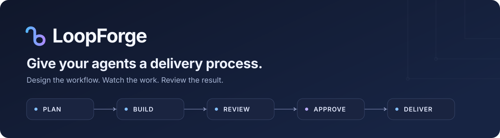
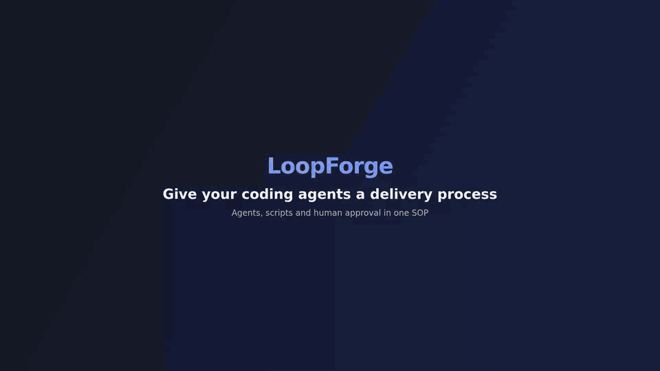
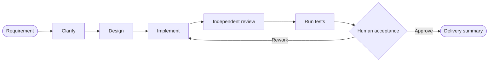
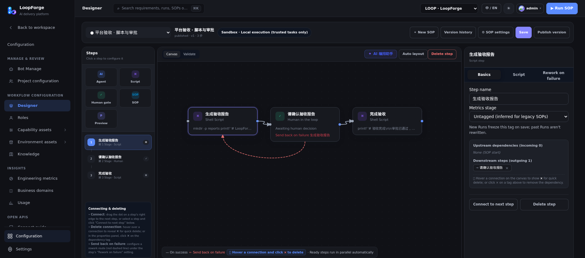
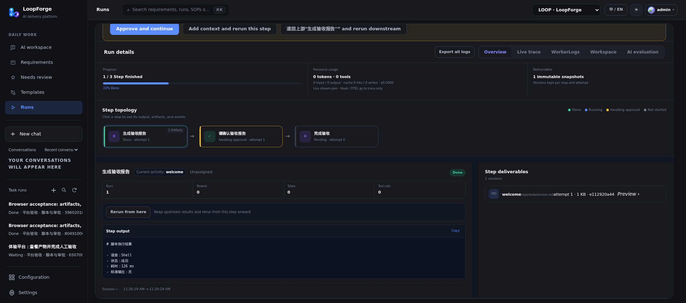

<p align="center">
  
</p>

<h3 align="center">Turn the way your team ships into a workflow coding agents can run.</h3>

<p align="center">
  Plan → implement → independent review → real tests → human sign-off — every time, not just when the agent feels like it.
</p>

<p align="center">
  <a href="https://github.com/Tencent/LoopForge/actions/workflows/platform.yml"></a>
  <a href="https://www.npmjs.com/package/loopforge-cli"></a>
  <a href="LICENSE"></a>
  
  <a href="https://github.com/Tencent/LoopForge/stargazers"></a>
</p>

<p align="center">
  <b>English</b> · <a href="README.zh-CN.md">简体中文</a>
</p>

<p align="center">
  <a href="#why-loopforge">Why</a> ·
  <a href="#quick-start">Quick start</a> ·
  <a href="#how-it-works">How it works</a> ·
  <a href="#features">Features</a> ·
  <a href="#loopforge-local">Local</a> ·
  <a href="#faq">FAQ</a> ·
  <a href="#documentation">Docs</a>
</p>

<p align="center">
  <a href="docs/assets/readme/demo-en.mp4"></a>
</p>

<p align="center"><sub>Recorded on a real install with no API key (1.6× speed): one click starts the demo SOP → a script writes a report → a human approves → the run finishes → the same SOP in the designer. <a href="docs/assets/readme/demo-en.mp4">Watch the full-quality MP4</a>.</sub></p>

**Watch the full-resolution demo (1080p, normal speed):**

https://github.com/user-attachments/assets/c9cc72fd-1df3-4ae3-9fe6-71d3e8770b65

**LoopForge** is a self-hosted platform that puts **coding agents, deterministic scripts and human decisions into one delivery workflow (SOP)**. Give each agent a role, connect the steps on a visual canvas, and follow every requirement from the first plan to the final artifact. When the process works, keep it — the next requirement runs the same way.

> Think **GitHub Actions for agent-driven delivery**: your process is the workflow, the agents fill in the intelligence at each step, and you stay in control of the gates.

## Why LoopForge

Ask a coding agent to "fix this bug" and the outcome depends on the run. It might skip the plan, forget the tests, review its own code, or stop halfway with nobody noticing. That is fine for a demo; it is not how a team ships.

LoopForge makes the process the fixed part and lets the AI be the flexible part:

- **Repeatable** — Same SOP, same stages, same checks, every requirement. Built-in backend, frontend, bug-fix and product SOPs to start from.
- **Separated roles** — Built-in delivery SOPs assign implementation, review and testing to different roles, each with its own instructions, rules, Skills and MCP tools. Customize the roles and review gates for your team.
- **Human in the loop** — Approval gates where it matters. Read the report, approve, or send the work back to a chosen stage.
- **Observable & resumable** — Node status, tool traces, logs and artifacts in one place. Pause, retry a failed step, or rerun from any node.
- **Bring your own stack** — CodeBuddy, Codex and Claude Code as executors; GitHub, Skills and MCP as tools; Docker sandboxes or your own machine as the runtime. MIT licensed.

## Quick start

Requires **Docker (with Compose)** and **Python 3**. The installer offers to install Docker if it is missing.

```bash
git clone https://github.com/Tencent/LoopForge.git
cd LoopForge
bash scripts/install.sh
```

Open **<http://localhost:8090>** and create your account — the first one becomes the administrator. The home page walks you through adding a model key and running your first SOP.

### Try a complete demo — no API key, no repository

Once installation and sandbox image preparation are complete, the script-and-approval demo usually takes about a minute. Cold-start build time depends on your machine and network.

1. On the home page, click **Try it now** (step 4 of the getting-started list). New accounts join the **LoopForge demo project** automatically.
2. The sample SOP runs a real script and saves its report. A short tour points out the step graph, the artifacts and the approval.
3. Approve the human gate and watch the SOP continue to its final artifact.

### What you need for your first real task

| I want to… | You need |
| --- | --- |
| Run the script + approval demo | Nothing |
| Chat, explore capabilities, generate a document or a new project | An API key for the selected executor |
| Work on an existing repository or open a PR | Model credentials + a GitHub repository + your Git token |

<details>
<summary><b>More setup details</b> — executors, GitHub, sandboxes, access model</summary>

<br>

- **Executors.** Pick **CodeBuddy, Codex or Claude Code** beside the home composer, then a model. Each executor uses its own credentials from personal settings, and every SOP role can choose its executor independently (built-in roles default to CodeBuddy). Requirement clarification, scheduled assistant tasks and AI notification summaries currently use CodeBuddy. The Docker image ships all three CLIs; [native deployments](docs/deployment.md#workers-and-runners) need the CLI for the executor you choose.
- **GitHub is optional.** All built-in generic SOPs run without a repository: product SOPs deliver documents, new frontend/backend projects deliver source files in the task workspace. Bug fixes still need source code and reproduction details. Connect a repository when you work on existing code or want PRs.
- **Delivering to a repository.** Add a GitHub repository, set your Git token and executor credentials in personal settings (or bind a local execution machine), open **SOPs → Built-in**, copy one into your project, create a requirement and start.
- **Sandboxes.** In the default Compose installation, SOP tasks use Docker sandbox containers started through the host Docker socket. The sandbox image builds in the background after the first start (a few minutes). Docker socket access grants control of the host daemon: this is for trusted teams, not untrusted multi-tenant isolation. See [deployment boundaries](docs/deployment.md#accounts). Re-running the installer keeps your data.
- **Accounts and access.** The default deployment listens on localhost and is designed for a trusted team: signed-in users can read project data across the instance, and teammates can sign up from the login page (`AGENTFLOW_ALLOW_SIGNUP=false` in `.env` turns that off). Read the [account and access model](docs/deployment.md#accounts) before exposing it beyond your team.
- **Remote access, HTTPS, separate workers** — see [Deployment](docs/deployment.md).
- **Hacking on LoopForge itself?** `bash scripts/dev.sh` runs it natively (Go 1.26.9+).

</details>

## How it works

An **SOP** is the workflow each delivery follows. Agents, scripts and people share the same run:



<p align="center">
  
</p>

<p align="center"><sub>The workflow designer. Drag Agent, Script, Human gate and sub-SOP nodes onto the canvas, wire them up, publish a version.</sub></p>

| Node | What it does |
| --- | --- |
| **Agent** | A role (instructions + executor + rules + Skills + MCP tools) that designs, implements, reviews or tests. |
| **Script** | A deterministic shell step: build, test, lint, generate a report. No AI where AI is not needed. |
| **Human gate** | Pauses the run until someone inspects the artifacts and approves — or sends the work back to a stage. |
| **SOP** | Reuses another SOP as a sub-workflow. |

Each node declares its artifacts and dependencies; the engine advances steps as their dependencies complete. Publish versions of an SOP, start from a built-in one, and adapt its roles, rules and execution environment to your project.

## Features

| | |
| --- | --- |
| **Visual SOP designer** | Build workflows on a canvas with Agent, Script, Human gate and sub-SOP nodes. Rework-on-failure edges, version history and publishing. |
| **Roles for agents** | Define who does what — instructions, executor, model, rules, Skills and MCP tools per role. |
| **Requirement → run** | Create a requirement, pick an SOP, start. Clarification, execution, approvals and delivery all live in the workspace. |
| **Run details** | Node status, outputs, tool traces and logs side by side. Pause, retry, add context, or rerun from a chosen node. |
| **Artifacts & evidence** | Per-node artifact snapshots, workspace file browser and previews, so the evidence stays next to the result. |
| **Execution environments** | Platform workers, Docker sandboxes, or a connected local CLI execution machine using your own tools and repositories. |
| **GitHub integration** | Repository binding, issue/PR adapters and actor-scoped Git credentials for real delivery. |
| **Insights** | Engineering metrics, run history and usage analysis to improve the process over time. |
| **Team-ready** | Password accounts, projects and members, English/Chinese UI, light and dark themes, an OpenAPI-described HTTP API. |

## See it run

<p align="center">
  
</p>

<p align="center"><sub>The no-key demo: run a real script → save its report → wait for human approval → continue.</sub></p>

**A delivery we actually ran:** four CodeBuddy roles planned a Python fix, implemented it, reviewed it independently and summarized the delivery. Three real tests passed; the run waited for human approval, then verified the accepted code had not changed. The [reusable acceptance case](e2e/api/45-delivery-model.test.mjs) checks the files and results — see the [validation record](docs/validation.md) for scope and known gaps.

## LoopForge Local

Don't want to run a server? **LoopForge Local** brings the built-in delivery workflows straight into the coding assistant you already use:

```bash
# Run inside your target project, e.g. for Claude Code
npx -y loopforge-cli@latest install claude
```

Then run `/start-devflow "<your request>"` in Claude Code.

| Host | Supported |
| --- | --- |
| Claude Code · CodeBuddy · Codex · Cursor | Classic (default) and Portable editions |
| Pi | Portable edition |

See the [local guide](docs/local/usage.md) for each host's entry point. Source lives in [`local/`](local/). Local runs the built-in workflows today; exporting a platform SOP for standalone local execution is planned.

| | Platform | Local |
| --- | --- | --- |
| Best for | Teams sharing SOPs, approvals and history | One developer inside an IDE / CLI |
| Needs | Docker + Python 3 | Node.js 20+ + Python 3.8+ + a coding assistant |
| Workflows | Custom SOPs on a visual canvas | Built-in Classic / Portable workflows |
| Evidence | Shared run details, approvals and metrics in the web workspace | Artifacts under `artifacts/{task_slug}/` + optional local dashboard |

## FAQ

**Do I need an API key to try it?**
No. The welcome SOP uses a script and a human gate only. You need a key for the executor you pick once agent steps are involved. Model usage is not included — you bring your own credentials.

**Do I need GitHub?**
No. Chat, documents and new projects run in the task workspace. Connect GitHub when you want to change an existing repository or open PRs.

**How is this different from Dify, n8n or Flowise?**
Those are general-purpose AI / automation workflow builders. LoopForge is built for **software delivery with coding agents**: roles like implementer and reviewer, Docker sandboxes and code workspaces, GitHub delivery, human acceptance gates and run evidence.

**How is this different from just using Claude Code / Codex / CodeBuddy?**
LoopForge doesn't replace them — it orchestrates them. Each agent step runs one of those CLIs; LoopForge adds the process around it: who does what, in which order, with which checks, and who signs off.

**Is it safe to expose on the internet?**
The default listens on localhost and targets a trusted team. Read the [account and access model](docs/deployment.md#accounts) and set up HTTPS before opening it up. Report vulnerabilities privately via the [security policy](SECURITY.md).

## Documentation

| I want to… | Start here |
| --- | --- |
| Deploy, manage accounts, connect execution machines | [Deployment](docs/deployment.md) |
| Install local workflows or choose an edition | [LoopForge Local](docs/local/usage.md) |
| Extend the platform or use the API | [Architecture](docs/architecture.md) · [API reference](docs/api/README.md) |
| Check functional coverage and release readiness | [Validation record](docs/validation.md) · [Acceptance matrix](docs/testing/acceptance-matrix.md) · [Release review](docs/release-readiness.md) |
| Understand source provenance and maintenance | [Public scope](docs/open-source-scope.md) · [Upstream synchronization](docs/upstream-sync.md) |

## Community

Scan the QR code below to join the LoopForge community group.


## Contributing

Issues and PRs are welcome — share a use case, report a bug, or improve workflows, integrations and the platform experience. Start with the [contributing guide](CONTRIBUTING.md). Security issues go through the [security policy](SECURITY.md).

If LoopForge is useful to you, a star helps others find it.

<a href="https://star-history.com/#Tencent/LoopForge&Date">
  
</a>

## License

[MIT](LICENSE). Third-party components keep their own licenses and notices; see [THIRD_PARTY_NOTICES.md](THIRD_PARTY_NOTICES.md).
