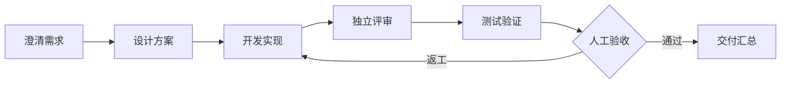

<p align="center">
  
</p>

<p align="center">
  <a href="README.md">English</a> · <b>简体中文</b>
</p>

<p align="center">
  <a href="#快速开始">快速开始</a> · <a href="#搭建你的交付闭环">交付闭环</a> · <a href="#loopforge-local">本地工作流</a> · <a href="#文档与贡献">文档与贡献</a>
</p>

<p align="center">
  <a href="LICENSE"></a>
  
  
</p>

**让 Agent 接住需求，也接住团队的交付方法。**

LoopForge 将 **编程 Agent、脚本和人工决策放进同一条交付流程**。描述需求，为每个角色明确分工，跟进从方案到产物的全过程。把跑通的方法存成 SOP，下一个任务继续复用。

- **流程由你设计。** 在可视化画布中编排实现、独立评审、测试等角色，接入团队已有的规则和工具。
- **关键节点由你把关。** 查看产物后审批，失败时重试指定步骤，需要时打回返工。
- **工具和环境由你选择。** CodeBuddy、Codex、Claude Code、GitHub、Skills、MCP；自主部署，**MIT 开源**。

<p align="center">
  
</p>

<p align="center"><sub>真实流程设计器：用脚本生成报告，经人工确认后继续执行。Agent 节点也可从左侧加入流程。</sub></p>

## 快速开始

需要 **Docker（含 Compose）和 Python 3**。没装 Docker 时，安装脚本会询问并帮你安装（Linux 用 get.docker.com，macOS 用 Homebrew）。在终端执行：

```bash
git clone https://github.com/Tencent/LoopForge.git
cd LoopForge
bash scripts/install.sh
```

打开 **[http://localhost:8090](http://localhost:8090)** 创建账号，第一个账号自动成为管理员。团队成员可以在同一页面自助注册（如需关闭，在 `.env` 中设置 `AGENTFLOW_ALLOW_SIGNUP=false`）。进入首页后，新手引导会带你配置模型 Key 并跑通第一条 SOP。

安装脚本会构建镜像、启动 MySQL 和平台，并初始化内置 SOP 和体验项目。AI SOP 在 Docker 沙箱容器里运行，由平台通过宿主机的 Docker socket 启动；首次启动后平台会在后台构建沙箱镜像（需要几分钟）。重复执行安装脚本会保留已有数据。如果要参与 LoopForge 本身的开发，可以用 `bash scripts/dev.sh` 原生运行（需要 Go 1.26.9+）。远程访问、HTTPS 和独立 Worker 配置见[部署指南](docs/deployment.md)。

默认仅监听本机，适合可信团队自托管。已登录用户可以读取实例内各项目的数据；对团队以外开放访问前，请先阅读[账号与访问边界](docs/deployment.md#accounts)。

**先体验完整的一次运行，无需模型密钥：**

1. 在首页「快速上手」清单里点第 4 步的 **一键体验**。新注册的账号会自动加入 **LoopForge 体验项目**。
2. 示例 SOP 先用脚本生成报告，页面上的引导气泡会依次指出节点图、产物和审批。
3. 在人工审批节点确认报告，再观察流程继续执行和最终产物。

GitHub 接入是可选的。聊天和不依赖仓库的文档生成任务只需要模型凭据；纯脚本和人工审批流程可以连模型 Key 都不配置。所有内置通用 SOP 都可不绑定仓库运行：产品方案交付文档，前后端新项目在任务工作区交付源码；缺陷修复仍需提供待修代码和复现材料。修改已有仓库或提交 PR 时，再按需绑定仓库并配置责任人的 GitHub Token。

| 想先做什么 | 需要准备什么 |
| --- | --- |
| 跑通脚本与人工审批体验 | 无需模型 Key，也无需仓库。 |
| 对话、了解能力、生成文档 | 所选执行器的 API Key。 |
| 分析私有代码、修改仓库、提交 PR | 模型凭据、GitHub 仓库，以及任务责任人的 Git Token。 |

**需要交付仓库代码时，再接入 GitHub：**

1. 添加 GitHub 仓库，在个人设置中配置 Git Token 和所需执行器的凭据，或绑定本机执行机器。
2. 打开 **SOP 流程 → 内置**，选一条 SOP。每张卡片都标出了运行条件（API Key、Docker，以及已绑定的 GitHub 仓库）；需要定制时复制到项目中调整。
3. 创建需求、选择 SOP 并启动，在工作台跟进执行、审批和交付。

在首页输入框旁选择 **CodeBuddy、Codex 或 Claude Code**，再选择模型；不同执行器分别使用个人设置里的对应凭据。SOP 角色也可以独立选择执行器。内置 SOP 角色默认使用 CodeBuddy，可以自行修改；需求澄清、定时助手任务和通知 AI 汇总目前使用 CodeBuddy。Docker 镜像包含三个 CLI；[原生部署](docs/deployment.md#workers-and-runners)需要安装所选执行器对应的 CLI。

## 搭建你的交付闭环

| 你要做的事 | 把它变成可以反复执行的流程 |
| --- | --- |
| **交付一个功能** | 明确验收标准、设计方案、完成实现，再交给独立角色评审。 |
| **修复一个 Bug** | 先复现、再修复、跑真实测试，把验证证据与结果一起留下。 |
| **沉淀团队方法** | 将评审规则、Skills、脚本和人工验收编排成 SOP，供下一个需求复用。 |

SOP 就是每次交付遵循的工作流程。Agent、确定性脚本和人工决策，都在同一次运行中衔接：



从内置的后端、前端、缺陷修复或产品 SOP 开始，按项目需要调整角色、节点、规则和运行环境。

| 你要做的事 | LoopForge 如何支持 |
| --- | --- |
| **让 Agent 各司其职** | 定义角色的职责、执行器、规则、Skills 与 MCP 工具，分别承担设计、实现、评审等工作。 |
| **复用一套交付方法** | 在可视化画布中编排 Agent、脚本和审批节点，配置产物与节点依赖，保存和发布流程版本。 |
| **随时掌握执行进展** | 从需求查看对应运行，沿节点检查状态、输出、工具轨迹和日志，定位卡点；支持暂停、重试和从指定节点重跑。 |
| **在关键步骤做决定** | 设置人工审批，检查报告与交付物，通过后继续；需要返工时回到指定环节。 |
| **使用自己的执行环境** | 按需使用平台 Worker、Docker 沙箱，或绑定本机 CLI 执行机器，接入已有工具与仓库。 |
| **把结果留给团队** | 按节点保留交付物快照，查看工作区文件与预览，结合可选外部知识服务、运行记录和用量分析持续改进流程。 |

## 看见过程，也检查结果

运行记录将节点状态、执行日志和产物放在一起。你可以查看报告后再审批，也可以在失败节点检查原因、补充信息并重试。

<p align="center">
  
</p>

<p align="center"><sub>无模型密钥体验流程：真实脚本执行 → 保存报告 → 等待人工审批 → 继续执行。</sub></p>

界面支持 **中英切换与浅色／深色主题**。模型与工具凭据由部署方配置；平台不附带模型额度。

**我们实际跑过的一次交付：** 四个 CodeBuddy 角色依次完成 Python 修复的规划、实现、独立评审和交付汇总；三个真实测试通过，运行等待人工批准，批准后再次验证代码与验收时的哈希一致。这条链路已沉淀为[可复用验收用例](e2e/api/45-delivery-model.test.mjs)。完整覆盖范围和未联调项见[实测记录](docs/validation.md)。

## LoopForge Local

希望直接在已有编程助手中使用本地开发工作流，可以选择 **LoopForge Local**，无需启动平台：

```bash
# 在你的目标项目目录中安装，例如 Claude Code
npx -y loopforge-cli@latest install claude
```

在 Claude Code 中运行 `/start-devflow "<你的需求>"`。也支持 CodeBuddy、Codex、Cursor，以及 Portable 模式下的 Pi；各宿主入口见[本地使用指南](docs/local/usage.zh-CN.md)。

源码位于 [`local/`](local/)，保留已有安装命令和包名。Local 当前运行内置工作流；**平台 SOP 导出后在本地独立执行**是后续方向，尚未实现。

## 文档与贡献

| 我想了解 | 从这里开始 |
| --- | --- |
| 部署、账号、执行机器与凭据 | [部署指南](docs/deployment.md) |
| 本地工作流的安装、使用与版本选择 | [LoopForge Local](docs/local/usage.zh-CN.md) |
| 扩展平台或接入 API | [架构](docs/architecture.md) · [API 参考](docs/api/README.md) |
| 提交功能或修复问题 | [贡献指南](CONTRIBUTING.zh-CN.md) · [验收记录](docs/validation.md) |
| 了解来源与长期维护方式 | [开源范围](docs/open-source-scope.md) · [上游同步策略](docs/upstream-sync.md) |

欢迎通过 [Issues](https://github.com/Tencent/LoopForge/issues) 分享使用场景、报告问题，或提交 PR 改进流程、工具适配和平台体验。安全问题请按[安全政策](SECURITY.zh-CN.md)私密报告。

## 许可证

[MIT](LICENSE)。第三方组件保留各自许可证与版权声明，见 [THIRD_PARTY_NOTICES.md](THIRD_PARTY_NOTICES.md)。
