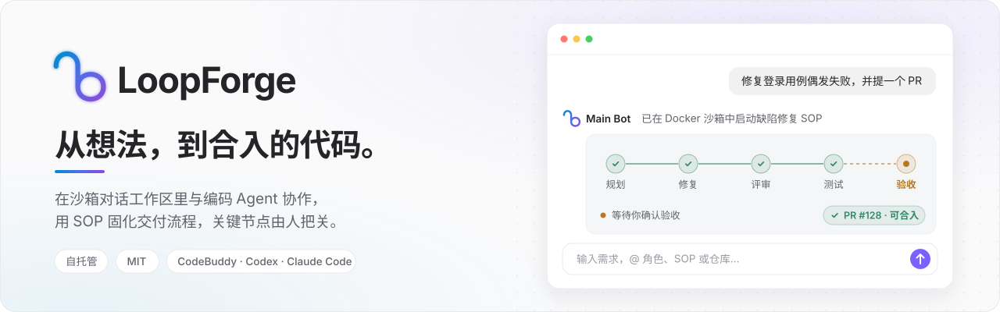
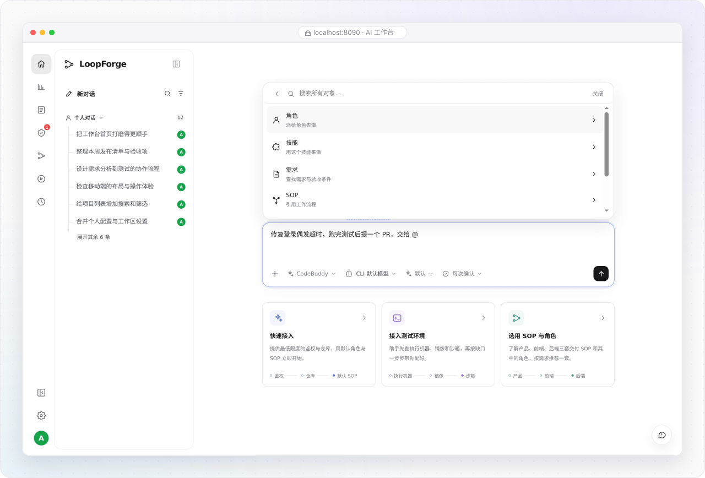
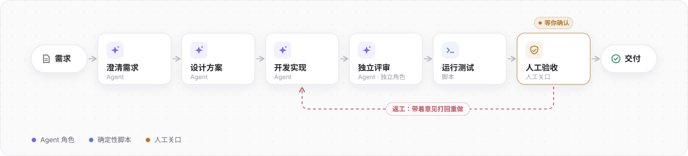
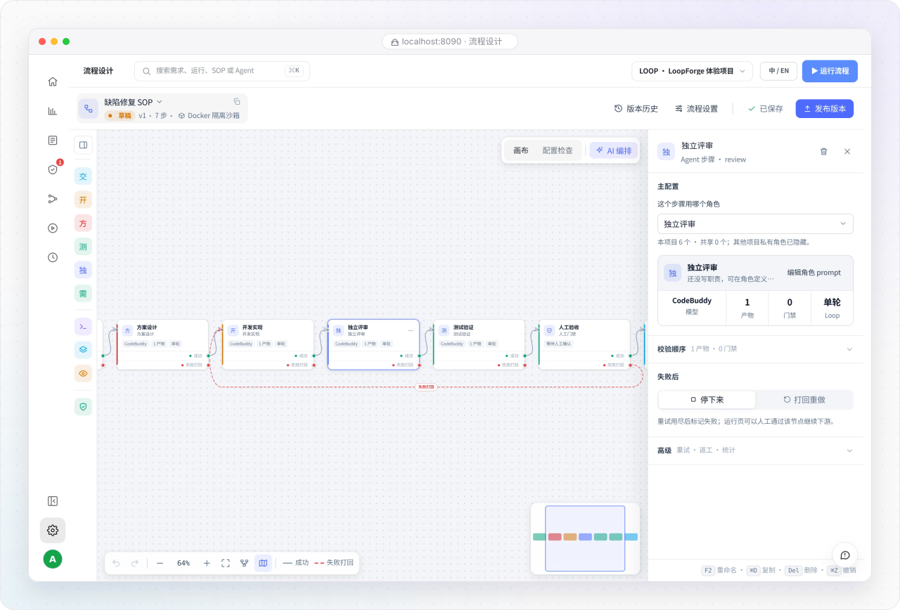
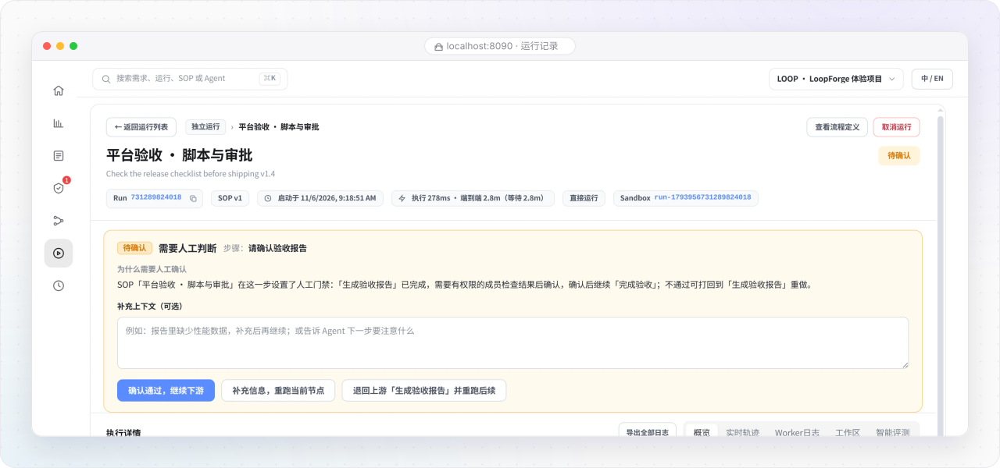
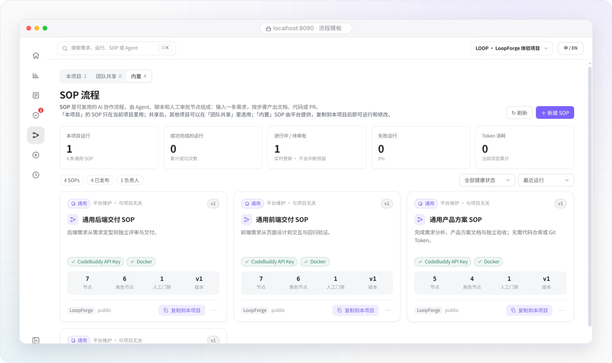

<p align="center">
  <picture>
    <source media="(prefers-color-scheme: dark)" srcset="docs/assets/readme/hero-zh-dark.svg">
    
  </picture>
</p>

<p align="center">
  <a href="https://github.com/Tencent/LoopForge/actions/workflows/platform.yml"></a>
  <a href="https://www.npmjs.com/package/loopforge-cli"></a>
  <a href="LICENSE"></a>
  
  <a href="https://github.com/Tencent/LoopForge/stargazers"></a>
</p>

<p align="center">
  <a href="README.md">English</a> · <b>简体中文</b>
</p>

<p align="center">
  <a href="#两种工作方式">两种工作方式</a> ·
  <a href="#快速开始">快速开始</a> ·
  <a href="#sop-如何运行">SOP</a> ·
  <a href="#功能一览">功能</a> ·
  <a href="#loopforge-local">本地版</a> ·
  <a href="#常见问题">FAQ</a> ·
  <a href="#文档">文档</a>
</p>

https://github.com/user-attachments/assets/10b8ae2e-d7e7-4b78-8876-c45818d4a08f

<p align="center"><sub>80 秒产品演示（1080p，有声）。</sub></p>

**LoopForge** 是一个可自主部署的团队工作台，让你和编程 Agent 一起交付软件。在对话里把需求告诉 **Main Bot**：它会按需打开 Docker 沙箱、检出项目仓库、把任务分派给项目角色，最后提交 PR。某种做法被验证有效后，把它存成 **SOP**（由 Agent、脚本和人工关口组成的标准交付流程），下一个需求就按同样的方式交付，评审和验收都在流程里。

干活的是 CodeBuddy、Codex 和 Claude Code；LoopForge 负责它们外面的角色、沙箱、检查点和留痕，全部运行在你自己的环境里，MIT 开源。

## 两种工作方式

| | **与 Main Bot 对话** | **运行 SOP** |
| --- | --- | --- |
| 适合 | 探索、快速修复、与 Agent 反复迭代 | 阶段固定、需要签字确认的可重复交付 |
| 如何运行 | Main Bot 按需打开[对话工作区](docs/conversation-workspaces.md)（带项目仓库的 Docker 沙箱），并把项目角色作为子 Agent 调用 | 引擎按顺序执行 Agent、脚本、人工关口和子 SOP 节点，每次运行有独立沙箱 |
| 你如何把控 | 回复中途排队或「引导」消息；在对话里暂停、恢复或接管正在运行的 SOP | 在人工关口审批；打回到指定环节返工；从任意节点重试或重跑 |
| 交付物 | PR/MR，或直推合入共享分支（`mode=direct`） | 文档、代码或 PR，以及每个节点的产物和日志 |

两种方式都挂在同一套**需求**上：无论改动来自对话还是 SOP，都能追溯到原始需求，并计入交付与成本统计。

<p align="center">
  <picture>
    <source media="(prefers-color-scheme: dark)" srcset="docs/assets/readme/chat-home-dark.svg">
    
  </picture>
</p>

<p align="center"><sub>对话首页：描述需求，用 <code>@</code> 引用角色、技能、需求、SOP 或仓库；每个会话可单独选择执行器、模型和确认模式。</sub></p>

## 为什么需要 LoopForge

让编程 Agent "修一下这个 Bug"，结果往往取决于这一次的运行：可能跳过方案，可能忘了跑测试，可能自己评审自己的代码，也可能做到一半停下而没人发现。做演示没问题，但团队交付不能这样。

- **可重复。** 同一条 SOP、同样的阶段、同样的检查，每个需求都一样。内置后端、前端、缺陷修复、产品方案四类 SOP 可直接起步。
- **角色分离。** 方案、实现、评审、测试各有独立的角色提示词、执行器、模型、规则、Skills 和 MCP 工具；同一个角色既能做 SOP 节点，也能在对话中作为子 Agent 调用。
- **人在回路。** 在关键节点设置人工审批：看完报告再放行，或打回到指定环节返工。
- **可观测、可续跑。** 节点状态、工具轨迹、日志和产物集中呈现；支持暂停、重试失败步骤、从任意节点重跑。
- **技术栈和服务器都是你的。** 执行器可选 CodeBuddy、Codex、Claude Code；工具接入 GitHub、Skills、MCP；运行环境可选 Docker 沙箱或你自己的机器。

## 快速开始

需要 **Git、curl、Docker（含 Compose）** 和 **Python 3**。全新 Ubuntu 可先运行 `sudo apt-get update && sudo apt-get install -y git curl python3`。没装 Docker 时，安装脚本会询问并帮你安装。支持普通用户运行，需要时通过 docker 组或 sudo 操作 Docker。

```bash
git clone https://github.com/Tencent/LoopForge.git
cd LoopForge
./start.sh
```

`./start.sh` 直接拉取 `compose.yaml` 中 pin 的 GHCR 发布镜像，不在本地构建（`bash scripts/install.sh` 效果相同）。用 `./start.sh logs`、`stop`、`restart`、`pull` 管理服务；需要从源码构建时用 `./start.sh dev`。

打开安装脚本输出的地址创建账号，第一个账号自动成为管理员。服务默认监听 `0.0.0.0:8090`；在云主机上，安装脚本会从云厂商的元数据服务读取公网 IP 并直接打印出来，放通安全组端口即可访问，或配置 HTTPS 反向代理；管理员账号创建前，建议只允许你的 IP 访问。首页的「快速接入」会带你配置模型凭据、绑定仓库并选好默认 SOP。

### 免 API Key 体验

新注册的账号会自动加入 **LoopForge 体验项目**，其中有一条只包含脚本和人工审批的 SOP：

1. 切换到体验项目，打开 **流程模板**，进入 **平台验收 · 脚本与审批**。
2. 点击 **运行流程**。真实脚本会生成一份报告，然后在审批节点等你确认。
3. 在 **待我确认** 或运行详情页审批通过，观察流程继续执行并产出最终产物。

### 真实任务需要准备什么

| 我想要… | 需要准备 |
| --- | --- |
| 跑通脚本 + 人工审批体验 | 什么都不需要 |
| 与 Main Bot 对话、生成文档或新项目 | 所选执行器的 API Key |
| 修改已有仓库（通过对话或 SOP）并提交 PR | 模型凭据 + GitHub 仓库（在个人设置中连接 GitHub） |

<details>
<summary><b>更多配置说明</b>：执行器、GitHub、沙箱、访问模型</summary>

<br>

- **执行器。** 在首页输入框旁选择 **CodeBuddy、Codex 或 Claude Code**，再选择模型；不同执行器分别使用个人设置里的对应凭据。每个 SOP 角色都可以独立选择执行器（内置角色默认 CodeBuddy）。需求澄清、定时助手任务和通知 AI 汇总目前使用 CodeBuddy。Docker 镜像内置三个 CLI；[原生部署](docs/deployment.md#workers-and-runners)需安装所选执行器的 CLI。
- **GitHub 可选。** 所有内置通用 SOP 都可以不绑定仓库运行：产品方案交付文档，前后端新项目在任务工作区交付源码；缺陷修复仍需提供待修代码和复现材料。需要修改已有代码或提交 PR 时再绑定仓库。
- **交付到仓库。** 在个人设置中点击「连接 GitHub」，用设备码授权后选择自己的仓库（已内置 LoopForge 授权应用，无需申请 PAT，仍可手动填写 PAT），再配置执行器凭据（或绑定本机执行机器），之后既可以运行一条项目 SOP，也可以直接让 Main Bot 修改代码并提交 PR/MR。
- **沙箱。** 默认 Compose 安装中，SOP 运行和对话工作区都使用 Docker 沙箱容器，由平台通过宿主机 Docker socket 启动；默认沙箱复用已安装的运行镜像，安装后无需再构建；自定义 Dockerfile 仍单独构建。Docker socket 赋予平台控制宿主机 Docker 的权限，因此只适用于可信团队，不构成不可信多租户隔离边界；详见[部署边界](docs/deployment.md#accounts)。重复执行安装脚本会保留已有数据。
- **账号与访问。** 新安装默认监听所有网卡（已有安装保留原配置），面向可信团队：已登录用户可以读取实例内各项目的数据，团队成员可在登录页自助注册（在 `.env` 中设置 `AGENTFLOW_ALLOW_SIGNUP=false` 可关闭）。对团队以外开放前，请先阅读[账号与访问边界](docs/deployment.md#accounts)。
- **远程访问、HTTPS、独立 Worker。** 见[部署指南](docs/deployment.md)。
- **参与 LoopForge 本身的开发？** 用 `bash scripts/dev.sh` 原生运行（需要 Go 1.26.11+）。

</details>

## SOP 如何运行

**SOP** 就是每次交付遵循的工作流程。Agent、脚本和人在同一次运行中衔接：

<p align="center">
  <picture>
    <source media="(prefers-color-scheme: dark)" srcset="docs/assets/readme/sop-flow-zh-dark.svg">
    
  </picture>
</p>

<p align="center">
  
</p>

<p align="center"><sub>流程设计器中的内置缺陷修复 SOP。每个步骤选择一个角色；检查失败时可以打回到前面的步骤。</sub></p>

| 节点 | 作用 |
| --- | --- |
| **Agent** | 一个角色（提示词、执行器、模型、规则、Skills、MCP 工具），负责设计、实现、评审或测试。 |
| **脚本** | 确定性的 Shell 步骤：构建、测试、Lint、生成报告。不需要 AI 的地方就不用 AI。 |
| **人工关口** | 暂停运行，等人检查产物后放行，或打回到指定环节。 |
| **子 SOP** | 把另一条 SOP 作为子流程复用。 |
| **预览构建** | 构建静态站点并归档，供评审查看。 |

每个节点声明自己的产物和依赖，依赖完成后引擎自动推进下一步。从内置 SOP 起步，按项目调整角色、规则和执行环境，随着流程演进发布新版本。

<p align="center">
  
</p>

<p align="center"><sub>停在人工关口的运行：确认通过继续下游、补充信息重跑当前节点，或退回上游重做。</sub></p>

**我们实际跑过的一次交付：** 四个 CodeBuddy 角色依次完成 Python 修复的规划、实现、独立评审和交付汇总；三个真实测试通过，运行等待人工批准，批准后再次验证代码与验收时一致。这条链路已沉淀为[可复用验收用例](e2e/api/45-delivery-model.test.mjs)，覆盖范围和未联调项见[实测记录](docs/validation.md)。

## 功能一览

| 方向 | 能力 |
| --- | --- |
| **对话工作台** | Main Bot 支持按会话选择执行器、模型和确认模式；`@` 引用角色、技能、需求、SOP 和仓库；回复进行中发送的消息进入排队托盘，「引导」可打断当前回复立即发送；生成的文件在侧边产物抽屉中预览、看源码和下载。 |
| **对话工作区** | 按需创建带项目仓库的 Docker 沙箱，把项目角色作为原生子 Agent 调用，并能直接控制正在运行的 SOP 工作区：暂停、恢复或接管。 |
| **流程设计器** | 在画布上编排 Agent、脚本、人工关口、子 SOP 和预览构建节点；支持失败打回、配置检查、版本历史与发布。内置后端、前端、缺陷修复和产品方案 SOP。 |
| **角色** | 可复用的角色定义：提示词、执行器、模型、规则、Skills、MCP 工具、产物与门禁，SOP 节点和对话子 Agent 共用。 |
| **需求到交付** | 无论通过 SOP 还是直接在对话中交付，需求都全程跟踪；支持 PR/MR 状态跟踪、合入检测和共享分支直推。 |
| **运行与审批** | 实时节点状态、工具轨迹、Worker 日志、节点产物快照和工作区预览；所有等你处理的关口集中在 **待我确认**。 |
| **AI 定时任务** | 周期性 Agent 任务，具备完整的工作区、SOP 与 MCP 权限；共享任务市场提供带版本和参数的任务模板；新需求可自动派发 SOP。 |
| **统计与成本** | 研发效能指标、业务领域报表（可导出静态 HTML/SVG），以及按公开标准价核算的 SOP 与对话 Token 成本。 |
| **执行环境** | 平台 Worker、Docker 沙箱，或连接一台使用你自己工具和仓库的本地执行机器。 |
| **团队协作** | 密码账号、项目与成员、浅色 / 深色 / 跟随系统主题，以及有 OpenAPI 描述的 HTTP 与 MCP API。管理页面支持中英文，对话工作台目前为中文界面。 |

<p align="center">
  
</p>

<p align="center"><sub>内置 SOP 是平台维护的只读蓝图，复制到本项目后即可运行和修改。</sub></p>

## LoopForge Local

不想部署服务端？**LoopForge Local** 把内置交付工作流直接带进你正在用的编程助手：

```bash
# 在目标项目目录中执行，例如安装到 Claude Code
npx -y loopforge-cli@latest install claude
```

然后在 Claude Code 中运行 `/start-devflow "<你的需求>"`。

| 宿主 | 支持情况 |
| --- | --- |
| Claude Code · CodeBuddy · Codex · Cursor | Classic（默认）与 Portable 版 |
| Pi | Portable 版 |

各宿主的入口见[本地使用指南](docs/local/usage.zh-CN.md)，版本差异见[版本说明](docs/local/editions.md)，源码位于 [`local/`](local/)。Local 目前运行内置工作流；平台 SOP 导出后在本地独立执行是后续方向，尚未实现。

| | 平台版 | Local |
| --- | --- | --- |
| 适合 | 团队共享对话工作区、SOP、审批与运行记录 | 个人开发者在 IDE / CLI 中使用 |
| 依赖 | Docker + Python 3 | Node.js 20+、Python 3.8+ 和一个编程助手 |
| 工作流 | 与 Main Bot 对话 + 可视化画布自定义 SOP | 内置 Classic / Portable 工作流 |
| 证据留存 | Web 工作台中共享运行详情、审批和指标 | `artifacts/{task_slug}/` 下的产物 + 可选本地看板 |

## 常见问题

**体验需要 API Key 吗？**
不需要。体验 SOP 只包含脚本和人工审批。对话和 Agent 步骤需要所选执行器的 Key。平台不附带模型额度，凭据由你自己配置。

**必须接入 GitHub 吗？**
不必。对话、文档和新项目都在任务工作区完成。需要修改已有仓库或提交 PR 时再接入 GitHub。

**什么时候用对话，什么时候用 SOP？**
探索和迭代用对话，Main Bot 同样可以提交 PR。当你希望每个需求都按同一套做法交付，有固定的评审、测试和签字环节，就把它做成 SOP。Main Bot 可以启动、暂停和接管 SOP 运行，两种方式可以配合使用。

**和 Dify、n8n、Flowise 有什么区别？**
它们是通用的 AI / 自动化工作流搭建平台。LoopForge 专注于 **用编程 Agent 做软件交付**：实现者与评审者等角色分工、带真实仓库的 Docker 沙箱、GitHub 交付、人工验收关口和运行证据。

**和直接用 Claude Code / Codex / CodeBuddy 有什么区别？**
LoopForge 不替代它们，而是编排它们。每个 Agent 步骤和每轮对话都运行这些 CLI 之一；LoopForge 补上外面的部分：谁来做、在哪个沙箱里、按什么顺序、经过哪些检查、由谁签字。

**可以直接暴露到公网吗？**
新安装默认监听所有网卡，面向可信团队。开放前请阅读[账号与访问边界](docs/deployment.md#accounts)并配置 HTTPS。安全漏洞请按[安全政策](SECURITY.zh-CN.md)私密报告。

## 文档

| 我想了解 | 从这里开始 |
| --- | --- |
| 部署、账号、执行机器与凭据 | [部署指南](docs/deployment.md) |
| 对话工作区、AI 定时任务与 Token 成本口径 | [对话工作区](docs/conversation-workspaces.md) · [AI 定时任务](docs/ai-scheduled-task-capabilities.md) · [Token 成本统计](docs/token-pricing.md) |
| 本地工作流的安装、使用与版本选择 | [LoopForge Local](docs/local/usage.zh-CN.md) · [版本差异](docs/local/editions.md) |
| 扩展平台或接入 HTTP / MCP API | [架构](docs/architecture.md) · [API 参考](docs/api/README.md) · [共享定时任务 API](docs/api/shared-schedules.md) |
| 参与前端开发 | [前端设计约定](design.md) |
| 功能覆盖与发布就绪情况 | [实测记录](docs/validation.md) · [验收矩阵](docs/testing/acceptance-matrix.md) · [发布评审](docs/release-readiness.md) |
| 来源与长期维护方式 | [开源范围](docs/open-source-scope.md) · [上游同步策略](docs/upstream-sync.md) |

## 交流群

扫描二维码加入 LoopForge 交流群。


## 参与贡献

欢迎通过 Issue 和 PR 分享使用场景、报告问题，或改进流程、工具适配和平台体验。请先阅读[贡献指南](CONTRIBUTING.zh-CN.md)；安全问题请按[安全政策](SECURITY.zh-CN.md)私密报告。

如果 LoopForge 对你有帮助，欢迎点个 Star，让更多人看到它。

<a href="https://star-history.com/#Tencent/LoopForge&Date">
  
</a>

## 许可证

[MIT](LICENSE)。第三方组件保留各自许可证与版权声明，见 [THIRD_PARTY_NOTICES.md](THIRD_PARTY_NOTICES.md)。
