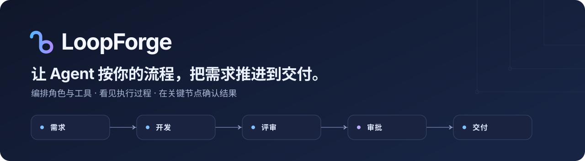
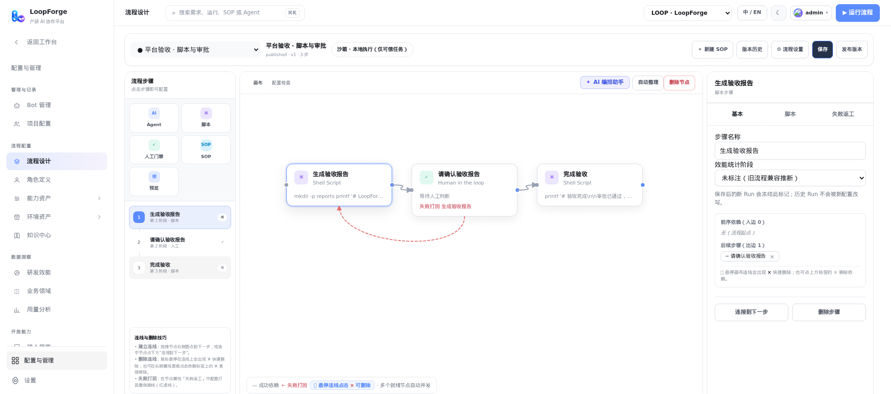
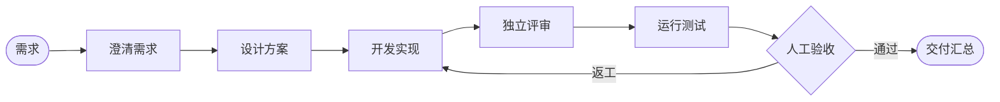
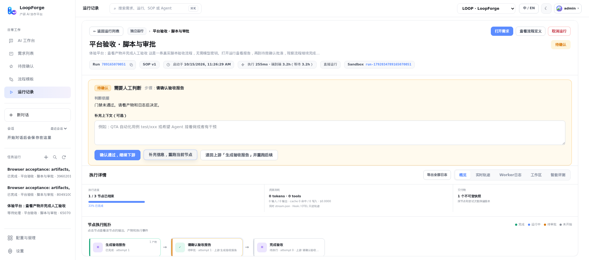

<p align="center">
  
</p>

<h3 align="center">把团队的交付方法，变成编程 Agent 能稳定执行的流程。</h3>

<p align="center">
  方案 → 实现 → 独立评审 → 真实测试 → 人工验收 —— 每一次都按流程走，而不是看 Agent 这次的发挥。
</p>

<p align="center">
  <a href="https://github.com/Tencent/LoopForge/actions/workflows/platform.yml"></a>
  <a href="https://www.npmjs.com/package/loopforge-cli"></a>
  <a href="LICENSE"></a>
  
  <a href="https://github.com/Tencent/LoopForge/stargazers"></a>
</p>

<p align="center">
  <a href="README.md">English</a> · <b>简体中文</b>
</p>

<p align="center">
  <a href="#为什么需要-loopforge">为什么</a> ·
  <a href="#快速开始">快速开始</a> ·
  <a href="#工作原理">工作原理</a> ·
  <a href="#功能一览">功能</a> ·
  <a href="#loopforge-local">本地版</a> ·
  <a href="#常见问题">FAQ</a> ·
  <a href="#文档">文档</a>
</p>

<p align="center">
  
</p>

<p align="center"><sub>真实的流程设计器：把 Agent、脚本、人工审批和子 SOP 节点拖到画布上连线，保存并发布版本。</sub></p>

**LoopForge** 是一个可自主部署的平台，把 **编程 Agent、确定性脚本和人工决策放进同一条交付流程（SOP）**。为每个 Agent 分配角色，在可视化画布上连接步骤，跟进每个需求从方案到最终产物的全过程。跑通的方法存成 SOP，下一个需求按同样的方式交付。

> 可以把它理解为 **面向 Agent 交付的 GitHub Actions**：流程由你定义，Agent 在每一步发挥智能，关键关口始终由你把控。

## 为什么需要 LoopForge

让编程 Agent "修一下这个 Bug"，结果往往取决于这一次的运行：可能跳过方案，可能忘了跑测试，可能自己评审自己的代码，也可能做到一半停下而没人发现。做演示没问题，但团队交付不能这样。

LoopForge 把流程固定下来，把灵活的部分留给 AI：

- **可重复** —— 同一条 SOP、同样的阶段、同样的检查，每个需求都一样。内置后端、前端、缺陷修复、产品方案四类 SOP 可直接起步。
- **角色分离** —— 实现、评审、测试由不同 Agent 承担，各自拥有指令、规则、Skills 和 MCP 工具。评审者永远不是作者本人。
- **人在回路** —— 在关键节点设置人工审批：看完报告再放行，或打回到指定环节返工。
- **可观测、可续跑** —— 节点状态、工具轨迹、日志和产物集中呈现；支持暂停、重试失败步骤、从任意节点重跑。
- **用你自己的技术栈** —— 执行器支持 CodeBuddy、Codex、Claude Code；工具接入 GitHub、Skills、MCP；运行环境可选 Docker 沙箱或你自己的机器。MIT 开源。

## 快速开始

需要 **Docker（含 Compose）** 和 **Python 3**。没装 Docker 时，安装脚本会询问并帮你安装。

```bash
git clone https://github.com/Tencent/LoopForge.git
cd LoopForge
bash scripts/install.sh
```

打开 **<http://localhost:8090>** 创建账号，第一个账号自动成为管理员。进入首页后，新手引导会带你配置模型 Key 并跑通第一条 SOP。

### 60 秒跑通完整流程 —— 无需 API Key，无需仓库

1. 在首页「快速上手」清单里点第 4 步的 **一键体验**。新注册的账号会自动加入 **LoopForge 体验项目**。
2. 示例 SOP 执行真实脚本并保存报告，页面上的引导气泡会依次指出节点图、产物和审批。
3. 在人工审批节点确认报告，观察流程继续执行并产出最终产物。

### 第一个真实任务需要准备什么

| 我想要… | 需要准备 |
| --- | --- |
| 跑通脚本 + 人工审批体验 | 什么都不需要 |
| 对话、了解能力、生成文档或新项目 | 所选执行器的 API Key |
| 修改已有仓库或提交 PR | 模型凭据 + GitHub 仓库 + 你的 Git Token |

<details>
<summary><b>更多配置说明</b> —— 执行器、GitHub、沙箱、访问模型</summary>

<br>

- **执行器。** 在首页输入框旁选择 **CodeBuddy、Codex 或 Claude Code**，再选择模型；不同执行器分别使用个人设置里的对应凭据。每个 SOP 角色都可以独立选择执行器（内置角色默认 CodeBuddy）。需求澄清、定时助手任务和通知 AI 汇总目前使用 CodeBuddy。Docker 镜像内置三个 CLI；[原生部署](docs/deployment.md#workers-and-runners)需安装所选执行器的 CLI。
- **GitHub 可选。** 所有内置通用 SOP 都可以不绑定仓库运行：产品方案交付文档，前后端新项目在任务工作区交付源码；缺陷修复仍需提供待修代码和复现材料。需要修改已有代码或提交 PR 时再绑定仓库。
- **交付到仓库。** 添加 GitHub 仓库，在个人设置中配置 Git Token 和执行器凭据（或绑定本机执行机器），打开 **SOP 流程 → 内置**，复制一条到项目中，创建需求并启动。
- **沙箱。** AI SOP 在 Docker 沙箱容器中运行，由平台通过宿主机 Docker socket 启动；首次启动后平台会在后台构建沙箱镜像（需要几分钟）。重复执行安装脚本会保留已有数据。
- **账号与访问。** 默认仅监听本机，面向可信团队：已登录用户可以读取实例内各项目的数据，团队成员可在登录页自助注册（在 `.env` 中设置 `AGENTFLOW_ALLOW_SIGNUP=false` 可关闭）。对团队以外开放前，请先阅读[账号与访问边界](docs/deployment.md#accounts)。
- **远程访问、HTTPS、独立 Worker** —— 见[部署指南](docs/deployment.md)。
- **参与 LoopForge 本身的开发？** 用 `bash scripts/dev.sh` 原生运行（需要 Go 1.26.9+）。

</details>

## 工作原理

**SOP** 就是每次交付遵循的工作流程。Agent、脚本和人在同一次运行中衔接：



| 节点 | 作用 |
| --- | --- |
| **Agent** | 一个角色（指令 + 执行器 + 规则 + Skills + MCP 工具），负责设计、实现、评审或测试。 |
| **脚本** | 确定性的 Shell 步骤：构建、测试、Lint、生成报告。不需要 AI 的地方就不用 AI。 |
| **人工审批** | 暂停运行，直到有人检查产物并批准 —— 或把工作打回到指定环节。 |
| **SOP** | 把另一条 SOP 作为子流程复用。 |

每个节点声明自己的产物和依赖，就绪的步骤会自动并行执行。SOP 支持版本发布；可以从内置 SOP 起步，再按项目调整角色、规则和运行环境。

## 功能一览

| | |
| --- | --- |
| **可视化 SOP 设计器** | 在画布上用 Agent、脚本、人工审批和子 SOP 节点编排流程；支持失败打回连线、版本历史和发布。 |
| **Agent 角色** | 定义谁做什么 —— 每个角色独立配置指令、执行器、模型、规则、Skills 和 MCP 工具。 |
| **需求 → 运行** | 创建需求、选择 SOP、启动。需求澄清、执行、审批和交付都在工作台中完成。 |
| **运行详情** | 节点状态、输出、工具轨迹和日志并排呈现；支持暂停、重试、补充上下文、从指定节点重跑。 |
| **产物与证据** | 按节点保留产物快照，可浏览工作区文件与预览，验证证据与结果放在一起。 |
| **执行环境** | 平台 Worker、Docker 沙箱，或绑定本机 CLI 执行机器，使用你自己的工具和仓库。 |
| **GitHub 集成** | 仓库绑定、Issue/PR 适配，以及按操作人隔离的 Git 凭据，用于真实交付。 |
| **数据洞察** | 研发效能指标、运行记录和用量分析，持续改进流程。 |
| **面向团队** | 账号密码登录、项目与成员管理、中英文界面、浅色／深色主题、带 OpenAPI 描述的 HTTP API。 |

## 实际运行效果

<p align="center">
  
</p>

<p align="center"><sub>无模型密钥体验流程：执行真实脚本 → 保存报告 → 等待人工审批 → 继续执行。</sub></p>

**我们实际跑过的一次交付：** 四个 CodeBuddy 角色依次完成 Python 修复的规划、实现、独立评审和交付汇总；三个真实测试通过，运行等待人工批准，批准后再次验证代码与验收时一致。这条链路已沉淀为[可复用验收用例](e2e/api/45-delivery-model.test.mjs)，覆盖范围和未联调项见[实测记录](docs/validation.md)。

## LoopForge Local

不想部署服务端？**LoopForge Local** 把内置交付工作流直接带进你正在用的编程助手：

```bash
# 在目标项目目录中执行，例如安装到 Claude Code
npx -y loopforge-cli@latest install claude
```

然后在 Claude Code 中运行 `/start-devflow "<你的需求>"`。

| 宿主 | 支持情况 |
| --- | --- |
| Claude Code · CodeBuddy · Codex · Cursor | Classic（默认）与 Portable 版 |
| Pi | Portable 版 |

各宿主的入口见[本地使用指南](docs/local/usage.zh-CN.md)，源码位于 [`local/`](local/)。Local 目前运行内置工作流；平台 SOP 导出后在本地独立执行是后续方向，尚未实现。

| | 平台版 | Local |
| --- | --- | --- |
| 适合 | 团队共享 SOP、审批与运行记录 | 个人开发者在 IDE / CLI 中使用 |
| 依赖 | Docker + Python 3 | Node.js 20+ + Python 3.8+ + 编程助手 |
| 工作流 | 可视化画布自定义 SOP | 内置 Classic / Portable 工作流 |
| 证据留存 | Web 工作台中共享运行详情、审批和指标 | `artifacts/{task_slug}/` 下的产物 + 可选本地看板 |

## 常见问题

**体验需要 API Key 吗？**
不需要。欢迎 SOP 只包含脚本和人工审批。涉及 Agent 步骤后，需要所选执行器的 Key。平台不附带模型额度，凭据由你自己配置。

**必须接入 GitHub 吗？**
不必。对话、文档和新项目都在任务工作区完成。需要修改已有仓库或提交 PR 时再接入 GitHub。

**和 Dify、n8n、Flowise 有什么区别？**
它们是通用的 AI / 自动化工作流搭建平台。LoopForge 专注于 **用编程 Agent 做软件交付**：实现者与评审者等角色分工、Docker 沙箱与代码工作区、GitHub 交付、人工验收关口和运行证据。

**和直接用 Claude Code / Codex / CodeBuddy 有什么区别？**
LoopForge 不替代它们，而是编排它们。每个 Agent 步骤都运行这些 CLI 之一；LoopForge 补上外面的流程：谁来做、按什么顺序、经过哪些检查、由谁签字。

**可以直接暴露到公网吗？**
默认只监听本机，面向可信团队。开放前请阅读[账号与访问边界](docs/deployment.md#accounts)并配置 HTTPS。安全漏洞请按[安全政策](SECURITY.zh-CN.md)私密报告。

## 文档

| 我想了解 | 从这里开始 |
| --- | --- |
| 部署、账号、执行机器与凭据 | [部署指南](docs/deployment.md) |
| 本地工作流的安装、使用与版本选择 | [LoopForge Local](docs/local/usage.zh-CN.md) |
| 扩展平台或接入 API | [架构](docs/architecture.md) · [API 参考](docs/api/README.md) |
| 功能覆盖与发布就绪情况 | [实测记录](docs/validation.md) · [验收矩阵](docs/testing/acceptance-matrix.md) · [发布评审](docs/release-readiness.md) |
| 来源与长期维护方式 | [开源范围](docs/open-source-scope.md) · [上游同步策略](docs/upstream-sync.md) |

## 参与贡献

欢迎通过 Issue 和 PR 分享使用场景、报告问题，或改进流程、工具适配和平台体验。请先阅读[贡献指南](CONTRIBUTING.zh-CN.md)；安全问题请按[安全政策](SECURITY.zh-CN.md)私密报告。

如果 LoopForge 对你有帮助，欢迎点个 Star，让更多人看到它。

<a href="https://star-history.com/#Tencent/LoopForge&Date">
  
</a>

## 许可证

[MIT](LICENSE)。第三方组件保留各自许可证与版权声明，见 [THIRD_PARTY_NOTICES.md](THIRD_PARTY_NOTICES.md)。
