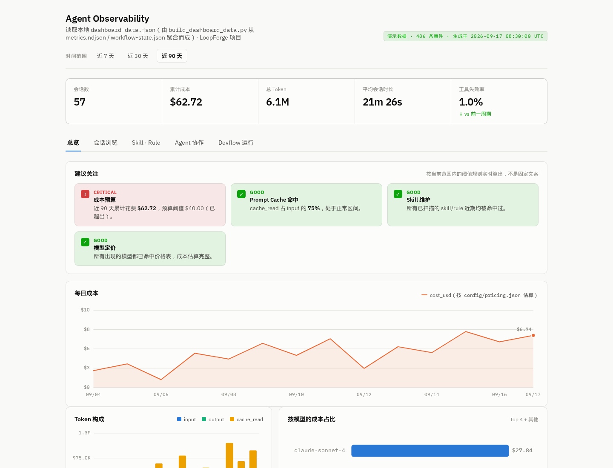

# LoopForge Local 使用指南

[English](usage.md) | 简体中文

LoopForge Local 在已有的编程助手中运行本地开发工作流，无需启动平台。当前支持内置的 Classic 和 Portable 工作流；平台 SOP 导出和独立执行尚未实现。平台部署见[部署指南](../deployment.md)。

## 快速开始

要求 Node.js 20+ 和 Python 3.8+。以下命令安装默认的 Classic Edition，不确定选哪一种时直接用这一版。

| Agent | 安装 | 启动工作流 |
| --- | --- | --- |
| CodeBuddy | `npx -y loopforge-cli@latest install codebuddy` | `/start-devflow "<需求>"` |
| Codex | `npx -y loopforge-cli@latest install codex` | `$devflow-codex "<需求>"` |
| Cursor | `npx -y loopforge-cli@latest install cursor` | `/start-devflow "<需求>"` |
| Claude Code | `npx -y loopforge-cli@latest install claude` | `/start-devflow "<需求>"` |

以 Claude Code 为例：

```bash
npx -y loopforge-cli@latest install claude
npx -y loopforge-cli@latest status claude
```

```text
/start-devflow "为订单列表增加状态筛选，并补充接口测试"
```

任何宿主都可以用 `npx -y loopforge-cli@latest status <agent>` 检查安装状态。如果安装或运行遇到问题，执行环境诊断：

```bash
npx -y loopforge-cli@latest doctor
```

Pi 通过 [Portable Edition](#portable-edition) 支持。

## 工作方式

1. **先理解问题**：Agent 调研现有项目，澄清目标、范围和验收标准，而不是立即开始写代码。
2. **确认边界后再实施**：中大型任务会在你确认目标、范围、排除项、关键决策和验收标准后，再进入设计与实现。
3. **分工完成交付**：设计、实现、审查和测试由职责独立的角色分阶段完成，减少同一上下文中的自审偏差。
4. **用证据说明结果**：需求、方案、代码变更、审查意见和测试结果都会落盘，方便检查、复盘和交接。
5. **中断后继续执行**：流程状态会被保存，下次可以从未完成的阶段继续，不必重新来过。

LoopForge 会根据任务复杂度选择路径：小改动走精简的单角色路径，避免为简单任务引入额外流程；中大型任务才启用完整的角色分工流程。

```text
你的需求
   │
   ├─ 小改动 ───────> 理解 → 实现 → 自检 → 交付
   │
   └─ 中大型任务 ───> 澄清并确认 → 设计 → 实现 → 独立审查 → 测试 → 交付
                              │
                              └── 全程保存状态和产物，可随时恢复
```

## 支持的 Agent

| Agent | Classic Edition（默认） | Portable Edition |
| --- | --- | --- |
| CodeBuddy | ✓ | ✓ |
| Codex | ✓ | ✓ |
| Cursor | ✓ | ✓ |
| Claude Code | ✓ | ✓ |
| Pi | — | ✓ |

同一项目中，每个编码 Agent 只能启用一种 Edition。两者的区别和目录说明见 [Edition selection](editions.md)。

## 你会得到什么

一次任务结束后，你会同时得到代码变更、已确认的需求、技术方案、独立审查意见、测试结果和交付总结。这些过程与结果默认保存在 `artifacts/{task_slug}/`，方便检查、复盘和交接。

<details>
<summary>查看默认产物目录</summary>

不同 Edition 的个别目录名称可能略有差异。

```text
01-requirement/   已确认的目标、范围与验收标准
02-design/        技术方案与执行计划
03-code/          代码变更与独立审查报告
04-e2e/           测试结果
05-knowledge/     可复用的项目知识
workflow-summary.md
```

</details>

Classic 工作流中断后，CodeBuddy、Cursor 和 Claude Code 使用 `/resume-devflow {task_slug}` 恢复，Codex 使用 `$devflow-codex resume {task_slug}`。状态查看、终止和单阶段命令见安装后对应宿主目录中的 README。

## 看见 Agent 如何完成工作

CodeBuddy 的 Classic Edition 内置本地可观测看板。它把落盘的流程证据变成可视化视图，集中呈现会话活动、Token 与成本趋势、Skill/Rule 使用情况、角色派发，以及 Devflow 阶段归因，方便定位高成本运行、确认自动化是否真正生效，并复盘任务如何在不同角色之间流转。



_看板示例使用合成演示数据。_

看板的数据聚合和页面服务都在本机完成，不依赖外部遥测服务。运行日志可能包含工具参数和输出片段，因此 LoopForge 默认将它们排除在 Git 之外；未经检查不应对外分享原始日志。

<details>
<summary>打开本地看板</summary>

在项目根目录至少运行一次 CodeBuddy 会话后执行：

```bash
python3 .codebuddy/skills/agent-observability/scripts/build_dashboard_data.py --project-root .
python3 -m http.server 8765 --directory .codebuddy/skills/agent-observability/scripts/dashboard
```

浏览器打开 `http://localhost:8765`。数据源、自定义模型定价和故障排查见[可观测性快速上手](../../local/.codebuddy/skills/agent-observability/references/quickstart.md)。

</details>

## 什么时候适合使用

LoopForge 尤其适合这些任务：

- 需求还比较模糊，需要先把目标和边界讨论清楚；
- 改动涉及多个模块，希望先形成方案再实施；
- 需要把实现、审查和测试交给不同角色完成；
- 任务可能跨越多个会话，需要保留状态并断点续跑；
- 团队希望留下可检查、可复盘的交付记录。

如果只是一次性的代码补全或非常明确的微小修改，直接使用编码 Agent 通常已经足够；LoopForge 会为进入其工作流的简单任务选择精简路径。

## Portable Edition

“快速开始”安装的 Classic Edition 适合大多数用户。如果只希望安装基于 Agent Skills 的可移植工作流，可以使用 Portable Edition。为避免同一个 Coding Agent 同时加载两套工作流，以及状态和产物相互冲突，LoopForge 在每个项目中只允许为同一 Coding Agent 启用一种 Edition。如需切换，可重新安装并添加 `--force`。

| Agent | 安装 | 启动工作流 |
| --- | --- | --- |
| CodeBuddy | `npx -y loopforge-cli@latest skills install codebuddy` | `/devflow "<需求>"` |
| Codex | `npx -y loopforge-cli@latest skills install codex` | `$devflow "<需求>"` |
| Cursor | `npx -y loopforge-cli@latest skills install cursor` | `/devflow "<需求>"` |
| Claude Code | `npx -y loopforge-cli@latest skills install claude` | `/devflow "<需求>"` |
| Pi | `npx -y loopforge-cli@latest skills install pi`，然后 `pi install npm:pi-subagents` | `/skill:devflow "<需求>"` |

完整边界和目录说明见 [Classic / Portable 说明](editions.md)。

## 更新与卸载

如果希望长期使用，可以全局安装 CLI：

```bash
npm install --global loopforge-cli
```

之后用上面的宿主名（`codebuddy`、`codex`、`cursor`、`claude`，Portable Edition 另有 `pi`）维护安装：

```bash
# Classic Edition
loopforge update <agent>
loopforge status <agent>
loopforge uninstall <agent>

# Portable Edition
loopforge skills update <agent>
loopforge skills status <agent>
loopforge skills uninstall <agent>
```

安装状态保存在 `.devflow/install-state.json`。检测到用户修改或文件冲突时，更新会停止而不是覆盖。只有在确认要替换冲突文件或切换 Edition 时才使用 `--force`，建议先运行 `loopforge plan` 检查变更。

如果已经克隆本仓库，也可以在仓库根目录从当前源码安装：

```bash
pipx install ./local
```

## 可选工具

`tools/tcmcp` 是腾讯云只读 MCP Initializr（Redis、CDB、TDSQL-C、TKE、CLS、COS）。它不包含在 `loopforge install` 或 npm CLI 包中。克隆仓库后：

```bash
cd local/tools/tcmcp
```

再按 [`tools/tcmcp/README.md`](../../local/tools/tcmcp/README.md) 启动。云 API 密钥不会写入生成的 zip 或容器镜像，只留在拉取资源或安装 MCP 客户端的本机。LoopForge 打 `vX.Y.Z` tag 发版时会发布 `ghcr.io/tencent/loopforge-tcmcp:<version>`。

## 权限与安全

部分宿主的 Classic 配置会启用自动执行或高权限 Agent 模式。请只在可信项目中使用；安装前可以通过 `loopforge plan codebuddy`、`loopforge plan codex`、`loopforge plan cursor` 或 `loopforge plan claude` 检查将写入的文件。不要把凭据、私有地址或生产运维配置写入工作流模板。

安全问题请参阅[统一安全政策](../../SECURITY.zh-CN.md)，并通过 GitHub Security Advisory 私密报告。
