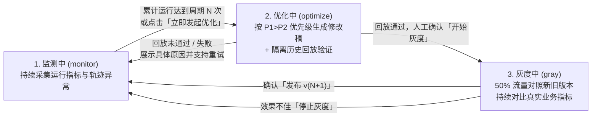
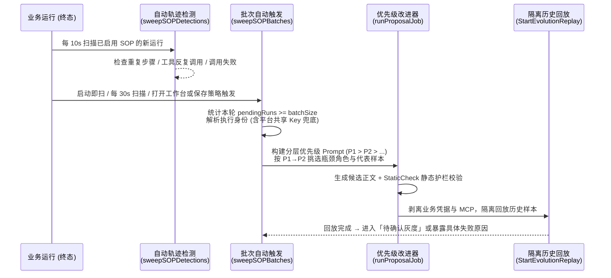

# LoopForge RSI 工作台使用与架构说明

> RSI（Recursive Self-Improvement，自进化）工作台以 **SOP（工作流）** 为核心维度，自动追踪每一次业务运行的成本、效率与质量指标，按用户设定的 **优化优先级（P1 > P2 > …）** 和 **汇总周期** 自动沉淀角色 Prompt / 规则的改进稿，经隔离历史回放与小流量灰度验证后安全发布，并支持随时一键回滚到任意历史版本。

---

## 一、核心理念与三阶段闭环

RSI 工作台将每个 SOP 的自进化过程收敛为清晰的 **三阶段闭环**：

- **按 SOP 显式启停、独立配置**：每个 SOP 默认关闭自动进化（避免升级后未配置 SOP 意外消耗 Token），按需打开开关即可生效；优先级、汇总周期、分析模型全部按 SOP 单独管理；右上角设置入口仍保留角色/规则 L0–L3 自治级别与固定验证样本配置。
- **所有改动可对比、可验证、可回滚**：不仅追踪 RSI 自动生成的优化提案，也会把通过 **Chatbot 对话修改**、**手动编辑资产** 和 **版本回滚** 产生的变更统一纳入 SOP 版本趋势与 Diff 视图。

---

## 二、界面与功能详解

### 1. 首页：SOP 进化列表（`#/evolution`）

打开「RSI 工作台」直接进入 SOP 维度列表，顶部仅保留简洁的刷新按钮、状态筛选（`全部 / 监测中 / 优化中 / 灰度中`）与名称搜索。每行展示一个 SOP 的核心状态：

| 列 | 说明 |
| --- | --- |
| **SOP 与最近分析** | SOP 名称、当前生效版本号（`vN`），以及最近 1 次运行的分析摘要（若有轨迹异常、Chatbot 刚修改或上次优化失败原因，会直接在此行提示）。 |
| **优化优先级 · 周期** | 以 `›` 展示当前优化顺序与触发周期（例如 `省 Token › 省工具 · 每 5 次`）；悬停可看完整 `P1 > P2 > ...` 链路，点击直接打开设置弹窗。 |
| **近批指标** | 最近一个统计批次的均值：**平均 Token**、**平均工具调用次数**、**SOP 综合评分**。 |
| **状态** | 当前所处阶段徽标：`监测中` / `优化中` / `灰度中`。 |
| **自动进化开关** | 按 SOP 独立启停自动进化；暂停后仍继续统计指标，但不会自动发起新的优化提案。 |

---

### 2. 优化优先级、汇总周期与独立模型设置

点击首页任意 SOP 的偏好胶囊，或详情页顶部的 `偏好 · P1 ...` 按钮，即可打开配置弹窗：

1. **优化优先级（`P1 主目标 > P2 > P3 > P4`）**
   - 可选四个核心优化维度：
     - **减少 Token（省 Token）**：压缩冗余上下文、重复调研与无效输出；
     - **减少工具调用（省工具）**：减少同一工具高频重复调用与报错重试；
     - **缩短执行耗时（提速度）**：减少节点串行返工与等待耗时；
     - **提高一次成功率（一次成功）**：降低失败与打回返工，提升一次通过率。
   - **快捷预设**：内置 `省成本（省 Token › 省工具）`、`提速度（提速度 › 省工具）`、`求稳定（一次成功 › 省 Token）` 一键排好顺序。
   - **排序与冲突裁决**：已选项按优先级置顶，第一项高亮标记为 **`P1 主目标`**；支持 **拖拽句柄（`⋮⋮`）** 或 **`↑` / `↓` 按钮** 实时调整顺序。未选项排在下方，勾选后追加至末尾。
2. **每轮汇总运行次数（1–100，默认 10）**
   - 提供 `每 5 / 10 / 15 / 20 / 30 次` 快捷按钮与自定义输入。
   - 当本轮累计的新增终态业务运行达到该阈值时，后台自动触发优化判断与提案生成。
3. **分析与优化模型**
   - 支持 **跟随默认**（使用项目或个人默认模型，缺省时可自动回退到平台共享 CodeBuddy Key）；
   - 或切换 **单独指定**，为单个 SOP 自由选择执行器（CodeBuddy / Codex / Claude Code 等）及具体模型。

---

### 3. SOP 详情页（`#/evolution/sops/:workflowId`）

点击任意 SOP 进入详情页，页面从上到下分为四部分：

#### （1）头部操作栏与实时状态横幅
- **操作栏**：`偏好 · P1 ...`、`版本与回滚 · vN`、`立即发起优化`（监测中可用）、`查看完整提案`（优化中/灰度中可用）。
- **状态横幅（透明展示所有关键状态，不静默卡死）**：
  - **优化中**：展示正在生成修改稿，或历史样本回放进度（已完成 `x/y` 条）；验证通过后直接提示「优化完成，是否开始灰度？」并提供一键 `开始灰度` 按钮。
  - **灰度中**：展示分流比例（默认 50%）、对照组与候选组已收集样本数及判定结论，提供 `停止灰度` 与 `发布 v(N+1)` 按钮。
  - **上次优化未通过**：若异步回放校验、静态检查或模型调用失败，顶部会直接标出具体报错原因，并提供 `查看失败详情` 与 `重试优化`。
  - **达阈值 / 待积累提示**：若已满足 `pending >= batchSize` 或历史提案刚结束正在积累新运行，横幅会清晰给出当前计数。

#### （2）5 大核心指标卡
一屏展示当前生效版本的 5 个核心指标（并与上一版本对比增减幅度，绿色代表改善、红色代表变差），同时在对应指标卡片上标出 **`P1 主目标`** 徽标：

| 指标 | 计算口径 |
| --- | --- |
| **SOP 评分（0–100）** | 若该批次存在自动评测结果（`RunEval`），直接取评测均分；暂无评测时按连续公式加权：一次成功为**结果稳定性 65 分** + **连续效率 35 分**（Token 15 + 工具 10 + 耗时 10）；返工成功按 0.6 倍计入效率分；失败运行不计效率分（8–18 分），确保 `失败 < 返工成功 < 一次成功`。 |
| **平均 Token** | 本批终态业务运行总 Token ÷ 运行数。 |
| **平均工具调用** | 本批累计工具调用次数 ÷ 运行数。 |
| **平均执行耗时** | 本批有效执行耗时均值。 |
| **一次成功率** | 无返工一次成功次数 ÷ 本批运行数。 |

#### （3）Tab 1：历史版本趋势 & 近几次灰度数据
- **历史正式版本**：
  - 支持在 5 项指标之间切换 Canvas 折线趋势图（自动适配明暗主题）。
  - 下方版本表列出每个正式版本的运行数、评分、Token、工具调用、耗时与一次成功率。
  - 若在工作流版本号未递增的情况下通过 **Chatbot**、**手动编辑** 或 **回滚** 修改了关联角色/规则，系统会自动按修改时间将当前版本拆分为「修改前」与「修改后（如 `v2 · Chatbot` / `v2 · 回滚`）」两个点，直观对比改动效果。
  - 每行右侧提供 **`回滚到 vN`** 或 **`版本历史 / 选择版本回滚`** 快捷操作。
- **近几次灰度数据**：
  - 展示每轮灰度的 `旧版 → 候选版` 状态与各项指标对比，点击 `明细` 可展开查看每次灰度运行被分流到「旧版对照」还是「候选版」以及单次消耗数据。

#### （4）Tab 2：本次修改与问题
- **本批统计证据条**：汇总本批样本量、总 Token、总工具调用、平均耗时与一次成功率。
- **本轮发现的问题**：按 SOP 优化优先级（`P1 · ...`、`P2 · ...`）排序展示问题卡片、命中次数与对应优化方向。
- **本次修改的文件（左右对比 Diff）**：
  - 默认以 **左右对比（Split Diff）** 展示「修改前（原版）」与「修改后（候选版）」，并支持一键切换为「行内视图」。
  - 多文件修改时支持标签页切换；当没有进行中的 RSI 提案时，也会直接展示最近的 **Chatbot / 手动修改 Diff**。

---

### 4. 版本时间线与一键回滚到指定 `vN`

任意角色 Prompt 和规则的每次发布、Chatbot 修改、手动编辑与回滚都会保存为不可变版本（`asset_versions`）：

1. **入口一（顶部按钮）**：点击 SOP 详情页右上角 **`版本与回滚 · vN`** 打开版本时间线抽屉；若 SOP 关联多个角色或规则，抽屉顶部可直接切换不同资产。
2. **入口二（历史版本表）**：在「历史版本趋势」表格右侧直接点击 **`回滚到 vN`** 或 **`选择版本回滚`**。
3. **对比与回滚行为**：
   - 在抽屉内点任意历史版本的 `对比`，可先查看 `vN → 当前正文` 的完整 Diff；
   - 点击 `回滚到此版` 并确认后，后端将 `vN` 正文写回线上资产，并**追加**一条 `source = rollback` 的新版本记录（不覆盖、不删除任何历史版本），已完成的运行记录不受影响，页面趋势与指标自动刷新。

---

## 三、后台自动化机制

### 1. 自动轨迹检测
- 后台 `monitorSOPDetection` 定期扫描所有已启用的 SOP 策略对应的新完成运行，无需旧版项目级总开关。
- 检测模型优先采用该 SOP 单独配置的模型，未配置时回退至默认模型。

### 2. 周期达标自动发起优化
- **触发时机**：服务启动时立即扫描一次；后台每 30 秒定时扫描；修改 SOP 策略后立即检查（`GET /api/evolution/overview` 保持严格只读，无写副作用）。
- **按 SOP 显式启用**：仅扫描显式开启自动进化开关（`Enabled = true`）的 SOP；未配置或已关闭开关的 SOP 不会后台触发自动优化或消耗 Token。
- **失败防抖不丢样本**：若某次提案失败（`failed`），不会清零当前批次已积累的运行次数；系统在 10 分钟冷却后自动重试（若有新运行完成或人工点击「重试优化」则立即执行）。
- **严格身份与凭据隔离**：后台自动检测与自动优化严格仅使用显式开启/保存该 SOP 策略的写权限成员身份（`policy.UpdatedBy`），绝不借用只读成员（`viewer`）或其他成员的个人 Key；若策略保存人未配个人 Key，可安全回退使用**平台共享 CodeBuddy Key**。

### 3. 优先级如何真正影响优化结果
1. **Prompt 冲突裁决**：`SOPPreferencePromptGuidance` 将用户排序转为显式分层指令——优先保障 **P1 主目标** 获得实质收益，次要目标仅在不损害更高优先级的前提下顺带优化，且严禁破坏产物正确性与验收门禁。
2. **瓶颈角色选择**：当 SOP 包含多个私有角色时，按 `P1 → P2 → …` 顺位比较各节点消耗（Token / 工具调用 / 执行耗时 / 失败与返工次数），自动锁定最关键的优化角色。
3. **样本与问题排序**：`BuildSOPPreferenceFinding` 按 `P1 → P2 → …` 多级排序挑出最具代表性的历史样本喂给改进器；详情页问题列表亦按优先级顺位排序。

---

## 四、安全边界与回放隔离

为防止历史回放对真实业务环境造成副作用，引擎在回放阶段执行严格的隔离与准入校验：

| 项目 | 隔离/校验策略 | 说明 |
| --- | --- | --- |
| **资产修改范围** | 仅允许修改当前项目的**私有角色 Prompt 与私有规则正文** | 共享或平台级资产不可直接修改，避免跨项目污染。 |
| **凭据与工具隔离** | 回放自动剥离 Git 凭据、部署凭据、项目 MCP、平台 MCP、知识库与业务通知 | 仅保留模型推理凭据，在独立临时工作区执行。 |
| **本地命令验收门禁** | **允许参与回放**（未绑定仓库且无外部凭据时） | 例如校验输出 `triage.json` 字段与格式，可直接作为候选稿正确性的自动门禁。 |
| **MR 验证门禁** | **拒绝回放** | 避免回放阶段检查或操作真实 MR。 |
| **绑定代码仓库（Git / MR）** | **拒绝回放** | 首版不支持带仓库的 Git / MR 流程历史回放。 |
| **脚本 / 命令 / 子 SOP 节点** | **拒绝回放** | 仅允许由 Agent 节点和审批节点构成的流程。 |
| **角色生命周期脚本（Hooks）** | **拒绝回放** | 防止 Hook 脚本执行外部写操作。 |
| **节点外部凭据（`CredentialEnv`）** | **拒绝回放** | 防止回放访问外部生产或测试系统。 |
| **静态检查护栏（`StaticCheck`）** | 强制校验 | 拒绝空正文、无改动正文、超长正文、正文缩水超过 2/3、或丢失 `{{input}}` 等关键占位符的候选稿。 |

---

## 五、核心 API 与代码结构速查

### 1. SOP 维度核心 API

| 方法 | 路径 | 用途 |
| --- | --- | --- |
| `GET` | `/api/evolution/overview?projectId=…&days=14` | 获取项目 RSI 概览与 SOP 列表（含状态、优先级、近批指标），达标 SOP 自动触发后台检查 |
| `GET` | `/api/evolution/sops?projectId=…&days=14` | 获取项目 SOP 汇总列表 |
| `GET` | `/api/evolution/sops/{workflowId}?projectId=…&days=14` | 获取 SOP 详情（5 项核心指标、版本趋势、灰度轮次、问题列表、左右 Diff、外部修改记录、关联资产与版本数） |
| `PUT` | `/api/evolution/sops/{workflowId}/policy` | 保存单个 SOP 的启停开关、有序优先级 `preferences`、汇总周期 `batchSize` 与专属 `model` |
| `POST` | `/api/evolution/sops/{workflowId}/optimize` | 立即为该 SOP 发起一次偏好驱动的优化提案 |
| `GET` | `/api/evolution/assets/{kind}/{id}/versions` | 获取角色/规则的完整版本历史与当前正文 |
| `POST` | `/api/evolution/assets/{kind}/{id}/rollback` | 将角色/规则回滚到指定历史版本 `version` |
| `POST` | `/api/evolution/proposals/{id}/approve` | 启动灰度（`mode: "canary"`）或全量发布（`mode: "release"`） |
| `POST` | `/api/evolution/proposals/{id}/reject` | 驳回提案或停止灰度 |

更多底层提案、排队、回放对比与样本接口详见 [docs/api/evolution.md](api/evolution.md)。

### 2. 前后端模块分布

| 模块 | 主要文件 | 职责 |
| --- | --- | --- |
| **领域模型** | `internal/domain/evolution.go` | SOP 策略、指标、版本趋势点、灰度轮次、外部编辑、资产引用与提案结构 |
| **指标与算法** | `internal/evolution/sop_metrics.go` `internal/evolution/improver.go` `internal/evolution/replay.go` | SOP 评分算法、版本趋势与外部编辑拆分、优先级 Prompt 生成、样本多级排序、紧凑 Diff 与回放判定 |
| **存储层** | `internal/repo/evolution.go` | `EvolutionRepo`（SOP 策略、提案、回放、资产不可变版本、运行 Pin、外部编辑版本记录） |
| **接口与调度** | `internal/httpapi/evolution_sop.go` `internal/httpapi/evolution_jobs.go` `internal/httpapi/evolution_detection.go` `internal/httpapi/evolution.go` | SOP 列表/详情/策略/优化端点、自动批次扫描、自动轨迹检测、异步提案生成与回放监控 |
| **引擎回放隔离** | `internal/engine/evolution_replay.go` | 回放准入安全校验、凭据/MCP 剥离、未受影响上游节点产出复用 |
| **前端工作台** | `web/app/evolution-sop.js` `web/app/evolution-sop.css` `web/evolution.js` | SOP 列表、优先级排序弹窗、详情页指标/趋势/灰度/左右 Diff、版本时间线抽屉与一键回滚 |

---

## 六、常见问题排查

1. **SOP 运行已满 N 次，为什么还没进入「优化中」？**
   - 直接打开该 SOP 详情页查看顶部横幅，或看首页列表行下方摘要：
     - **提示「上次优化未通过：…」**：说明自动优化已触发但被具体条件拦住（如绑定了代码仓库、包含 MR 验证或脚本节点、缺少可用模型凭据、角色为共享资产等），按提示处理后点击「重试优化」即可。
     - **提示「本轮待积累新运行（x/N）」**：说明此前已有结束的提案消费了旧运行，新运行累计满 `N` 次后会自动触发，也可直接点「立即发起优化」。
     - **开关已关闭**：打开首页右侧的「自动进化」开关即可恢复。
2. **通过 Chatbot 或手动改了角色 Prompt，RSI 会感知吗？**
   - 会。保存时后端会自动写入 `asset_versions`（标记为 `Chatbot 修改` 或 `手动修改`），SOP 详情页的「历史版本趋势」会自动拆分改动前后指标对比，并在「本次修改与问题」中展示左右 Diff。
3. **发布或改完后效果变差，怎么恢复到之前的 `vN`？**
   - 在 SOP 详情页点击右上角 **`版本与回滚`**，或在「历史版本趋势」表格右侧点 **`回滚到 vN`**，确认后即可无损恢复旧版正文并记一条回滚版本。
